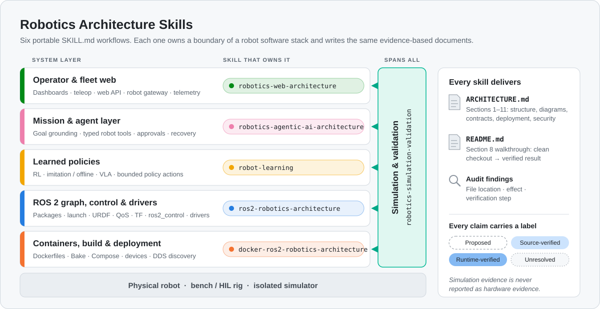
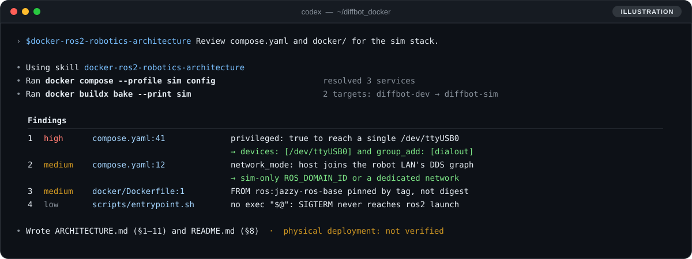
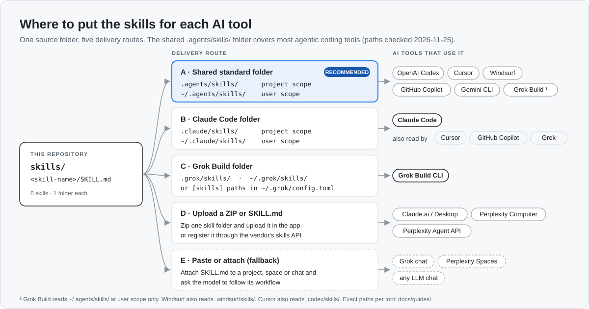
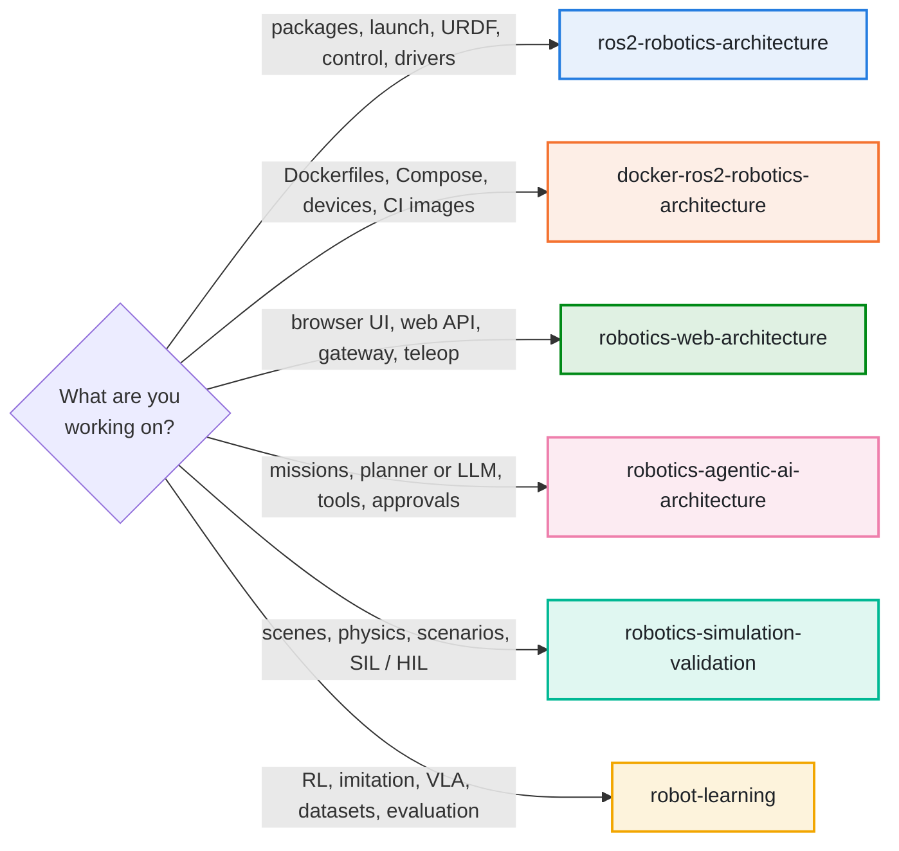
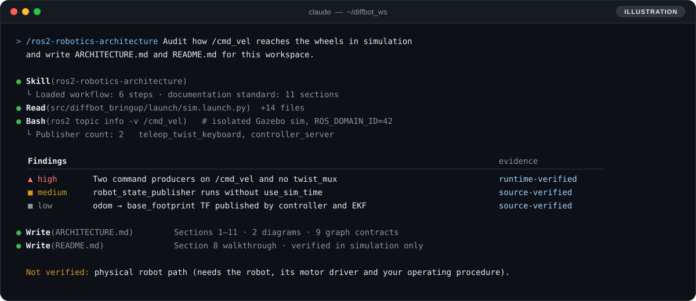
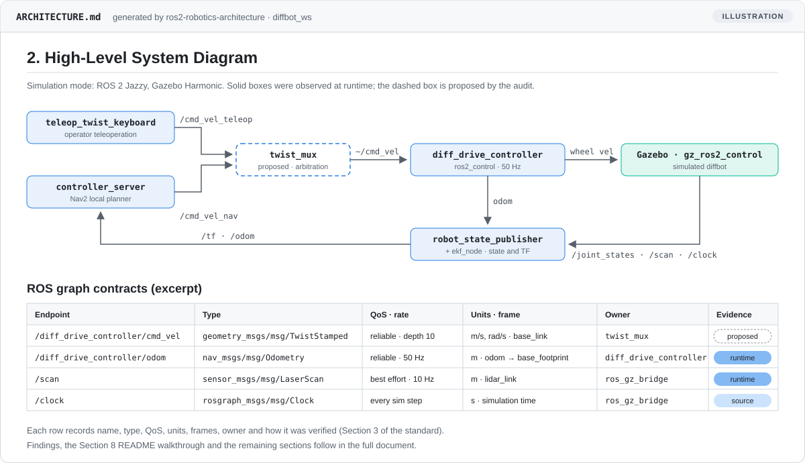
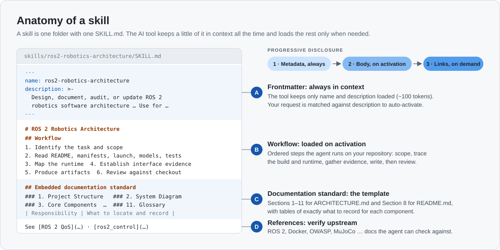
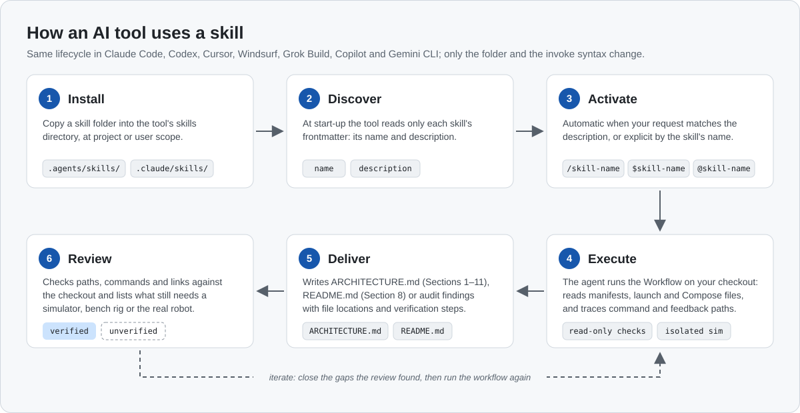
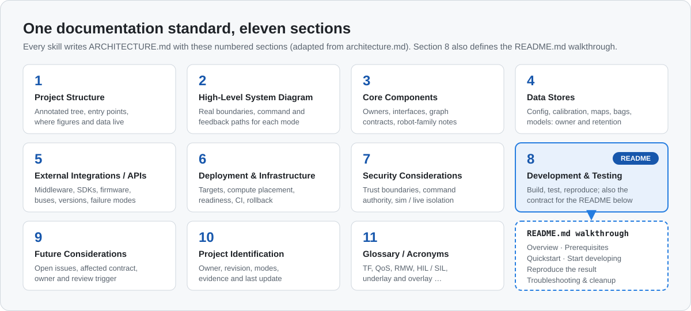
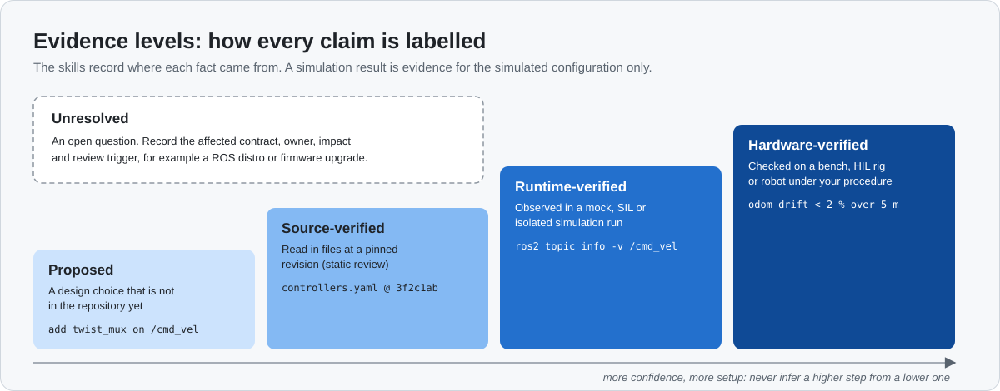

# Robotics Architecture Skills

<p align="center">
  <b>Six portable agent skills that teach AI coding assistants to design, document and audit robot software.</b>
</p>

<p align="center">
  <a href="https://agentskills.io"></a>
  <a href="#brief-review"></a>
  
  
  <a href="#license"></a>
</p>

<p align="center">
  <b>Works with</b><br/>
  <a href="docs/guides/claude-code.md"></a>
  <a href="docs/guides/openai-codex.md"></a>
  <a href="docs/guides/cursor.md"></a>
  <a href="docs/guides/windsurf.md"></a>
  <a href="docs/guides/grok.md"></a>
  <a href="docs/guides/perplexity.md"></a>
  <a href="docs/guides/other-tools.md#github-copilot-vs-code-copilot-cli-cloud-agent"></a>
  <a href="docs/guides/other-tools.md#gemini-cli"></a>
</p>

> [!TIP]
> To pin the exact version of the skills your team uses, download this repo and inside the folder do ***`git checkout <tag-or-commit>`***

<p align="center">
  <a href="#brief-review">📖 Brief Review</a> ·
  <a href="#using-the-skills">🚀 Using the Skills</a> ·
  <a href="#results">🏆 Results</a> ·
  <a href="#visual-explanation">🎨 Visual Explanation</a> ·
  <a href="#issues">⚠️ Issues</a> ·
  <a href="#future-work">🔭 Future Work</a> ·
  <a href="#contributing">🤝 Contributing</a> ·
  <a href="#license">📜 License</a>
</p>


<a id="brief-review"></a>
<details open>
<summary> 📖 <b>Brief Review</b></summary>

This project contains six portable **agent skills** (`SKILL.md` files). They teach an AI coding assistant to design, document, audit and update robotics software architecture: ROS 2 workspaces, Docker deployments, operator web apps, agentic mission layers, simulation and robot learning.

Every skill has the same two parts: a step-by-step **workflow** that the agent runs on your repository, and an embedded **11-section documentation standard**. The output therefore has the same structure whichever skill or AI tool produced it.

I based the document structure on [architecture.md](https://architecture.md/) and the packaging on the open [Agent Skills](https://agentskills.io) format, so the same folder works in Claude Code, OpenAI Codex, Cursor, Windsurf, Grok Build, GitHub Copilot, Gemini CLI and more. The skills link the technical references they rely on: [ROS 2 QoS](https://docs.ros.org/en/jazzy/Concepts/Intermediate/About-Quality-of-Service-Settings.html), [ros2_control](https://control.ros.org/jazzy/doc/getting_started/getting_started.html), [PX4 ROS 2](https://docs.px4.io/main/en/ros2/user_guide), [Docker runtime privileges](https://docs.docker.com/engine/containers/run/#runtime-privilege-and-linux-capabilities), [OWASP WebSocket security](https://cheatsheetseries.owasp.org/cheatsheets/WebSocket_Security_Cheat_Sheet.html), [Gymnasium](https://gymnasium.farama.org/), [MuJoCo](https://mujoco.readthedocs.io/en/stable/modeling.html), [Isaac Sim](https://docs.isaacsim.omniverse.nvidia.com/latest/) and the [agent development lifecycle](https://www.langchain.com/blog/the-agent-development-lifecycle).

The skills included. Each badge is the skill's internal `name` and opens its `SKILL.md`:
- 1 x [](skills/ros2-robotics-architecture/SKILL.md) **ROS 2 Robotics Architecture**: workspace and packages, launch, robot model, ROS graph contracts, control, drivers
- 1 x [](skills/docker-ros2-robotics-architecture/SKILL.md) **Docker ROS 2 Robotics Architecture**: Dockerfiles, Buildx Bake, Compose, entrypoints, devices, DDS discovery
- 1 x [](skills/robotics-web-architecture/SKILL.md) **Robotics Web Architecture**: dashboards, teleoperation, fleet consoles, robot gateways, telemetry and command APIs
- 1 x [](skills/robotics-agentic-ai-architecture/SKILL.md) **Robotics Agentic AI Architecture**: mission planning, typed robot tools, approvals, checkpoints, recovery
- 1 x [](skills/robotics-simulation-validation/SKILL.md) **Robotics Simulation & Validation**: models, scenes, physics, clocks, scenarios, SIL / HIL, sim-to-real evidence
- 1 x [](skills/robot-learning/SKILL.md) **Robot Learning**: reinforcement, imitation / offline and vision-language-action policies, datasets, evaluation, bounded deployment

Each skill works on its own or with the others. Every skill names its companion skill at the boundary it does not own. All of them are robot-agnostic: robot-family tables cover manipulators, legged robots, aerial robots, ground and marine platforms, and mobile manipulators.

> [!NOTE]
> - You need an AI tool that loads `SKILL.md` skills (see the [compatibility table](#compatibility)). Chat-only assistants can use the [paste-in fallback](docs/guides/other-tools.md#any-chat-assistant-prompt-template).
> - For runtime checks the agent needs a shell with ROS 2 and/or Docker. Without one, the skills still work and label every claim *source-verified*.
> - The skills never need hardware. Physical tests are documented as a separate step under your project's operating procedure.

The robotics stack each skill owns, and one example outcome:

<p align="center">


</p>

The project tree:

```text
robotics-architecture-skills/
├── README.md                                    # This guide
├── skills/                                      # What the AI tool loads (folder name = SKILL.md name)
│   ├── ros2-robotics-architecture/SKILL.md          # ROS 2 graph, control, drivers
│   ├── docker-ros2-robotics-architecture/SKILL.md   # Images, Compose, host boundary
│   ├── robotics-web-architecture/SKILL.md           # Operator UI, web API, robot gateway
│   ├── robotics-agentic-ai-architecture/SKILL.md    # Mission layer, tools, recovery
│   ├── robotics-simulation-validation/SKILL.md      # Scenes, scenarios, sim-to-real
│   └── robot-learning/SKILL.md                      # RL, imitation, VLA policies
└── docs/                                        # What people read
    ├── figures/
    │   ├── overview/        # skills-stack.svg, skill-anatomy.svg
    │   ├── workflow/        # skill-lifecycle.svg, eleven-sections.svg, evidence-ladder.svg
    │   └── integrations/    # install-map.svg
    ├── media/examples/      # Outcome illustrations: Claude Code, Codex, generated ARCHITECTURE.md
    ├── guides/              # One install-and-use guide per AI tool
    └── examples/            # Worked examples and the prompt cookbook
```

The project has two halves: `skills/` is what the AI tool loads, and `docs/` is what people read. Copy only the `skills/` folders into your tools.

</details>

<a id="using-the-skills"></a>
<details open>
<summary> 🚀 <b>Using the Skills</b></summary>

> [!NOTE]
> By default every skill **activates automatically** when your request matches its `description`. You can also call it by name.

**1. Clone this repo once**

```bash
git clone https://github.com/issaiass/robotics-architecture-skills ~/robotics-architecture-skills
```

**2. Copy the skills into the folder your AI tool reads.** The shared `.agents/skills/` folder covers most tools, and Claude Code uses `.claude/skills/`. Run this inside your robot repository:

```bash
# macOS / Linux / WSL
mkdir -p .agents/skills .claude/skills
cp -r ~/robotics-architecture-skills/skills/* .agents/skills/
cp -r ~/robotics-architecture-skills/skills/* .claude/skills/
```

```powershell
# Windows PowerShell
New-Item -ItemType Directory -Force .agents\skills, .claude\skills | Out-Null
Copy-Item -Recurse -Force "$HOME\robotics-architecture-skills\skills\*" .agents\skills\
Copy-Item -Recurse -Force "$HOME\robotics-architecture-skills\skills\*" .claude\skills\
```

**3. Ask for a task** in plain words, or call the skill by name:

```text
/ros2-robotics-architecture Audit how /cmd_vel reaches the wheels in simulation
and write ARCHITECTURE.md and README.md for this workspace.
```

**4. Review the output**: `ARCHITECTURE.md`, `README.md`, or a findings list, with each claim labelled *proposed*, *source-verified*, *runtime-verified* or *unresolved*.

<p align="center">

</p>

#### Compatibility

Paths checked against each vendor's documentation on **2026-11-25**.

| AI tool | Project folder | User folder | Call a skill | Reads your repo | Guide |
| --- | --- | --- | --- | :---: | --- |
| Claude Code | `.claude/skills/` | `~/.claude/skills/` | `/skill-name` | ✅ | [claude-code.md](docs/guides/claude-code.md) |
| Claude.ai / Desktop | upload a ZIP | — | name it in the chat | 📎 | [claude-code.md](docs/guides/claude-code.md#claudeai-and-claude-desktop) |
| OpenAI Codex | `.agents/skills/` | `~/.agents/skills/` | `$skill-name`, `/skills` | ✅ | [openai-codex.md](docs/guides/openai-codex.md) |
| ChatGPT | — | — | `@skill-name` | 📎 | [other-tools.md](docs/guides/other-tools.md#chatgpt) |
| Cursor | `.cursor/skills/`, `.agents/skills/` | `~/.cursor/skills/` | `/skill-name` | ✅ | [cursor.md](docs/guides/cursor.md) |
| Windsurf | `.windsurf/skills/`, `.agents/skills/` | `~/.codeium/windsurf/skills/` | `@skill-name` | ✅ | [windsurf.md](docs/guides/windsurf.md) |
| Grok Build CLI | `.grok/skills/` | `~/.grok/skills/` | `/skill-name` | ✅ | [grok.md](docs/guides/grok.md) |
| Grok chat | attach `SKILL.md` | — | prompt template | 📎 | [grok.md](docs/guides/grok.md#grok-chat-no-skill-loader) |
| Perplexity | upload (Computer, Agent API) | — | name it in the prompt | 📎 | [perplexity.md](docs/guides/perplexity.md) |
| GitHub Copilot | `.github/skills/`, `.agents/skills/` | `~/.copilot/skills/` | automatic | ✅ | [other-tools.md](docs/guides/other-tools.md#github-copilot-vs-code-copilot-cli-cloud-agent) |
| Gemini CLI | `.gemini/skills/`, `.agents/skills/` | `~/.gemini/skills/` | automatic, `/skills list` | ✅ | [other-tools.md](docs/guides/other-tools.md#gemini-cli) |
| Aider, any chat | `--read SKILL.md`, paste | — | prompt template | 📎 | [other-tools.md](docs/guides/other-tools.md#aider) |

✅ reads and runs checks on your local checkout · 📎 sees only the files you upload or paste

#### Install and call, per tool

<details>
<summary><b>Claude Code</b>: <code>~/.claude/skills/</code> · <code>/skill-name</code></summary>

```bash
mkdir -p ~/.claude/skills && cp -r ~/robotics-architecture-skills/skills/* ~/.claude/skills/
```

```text
/ros2-robotics-architecture <your task>
```

Full guide, including Claude.ai and Claude Desktop uploads: [docs/guides/claude-code.md](docs/guides/claude-code.md)

</details>

<details>
<summary><b>OpenAI Codex</b> (CLI or IDE): <code>~/.agents/skills/</code> · <code>$skill-name</code></summary>

```bash
mkdir -p ~/.agents/skills && cp -r ~/robotics-architecture-skills/skills/* ~/.agents/skills/
```

```text
/skills                                          # browse
$docker-ros2-robotics-architecture <your task>   # mention
```

Full guide, including ChatGPT and the built-in `$skill-installer`: [docs/guides/openai-codex.md](docs/guides/openai-codex.md)

</details>

<details>
<summary><b>Cursor</b>: <code>.cursor/skills/</code> · <code>/skill-name</code></summary>

```bash
mkdir -p .cursor/skills && cp -r ~/robotics-architecture-skills/skills/* .cursor/skills/
```

```text
/robotics-web-architecture <your task>
```

Cursor also reads `.claude/skills/` and `.codex/skills/`. Full guide: [docs/guides/cursor.md](docs/guides/cursor.md)

</details>

<details>
<summary><b>Windsurf</b> (Cascade): <code>.agents/skills/</code> · <code>@skill-name</code></summary>

```bash
mkdir -p .agents/skills && cp -r ~/robotics-architecture-skills/skills/* .agents/skills/
```

```text
@robotics-simulation-validation <your task>
```

Full guide, including Devin Local paths: [docs/guides/windsurf.md](docs/guides/windsurf.md)

</details>

<details>
<summary><b>Grok Build CLI</b>: <code>.grok/skills/</code> · <code>/skill-name</code></summary>

```bash
mkdir -p .grok/skills && cp -r ~/robotics-architecture-skills/skills/* .grok/skills/
```

```toml
# or skip copying: point Grok at the clone in ~/.grok/config.toml
[skills]
paths = ["/home/<you>/robotics-architecture-skills/skills"]
```

```text
/robot-learning <your task>
```

Full guide, including Grok chat: [docs/guides/grok.md](docs/guides/grok.md)

</details>

<details>
<summary><b>Perplexity</b> (Computer, Agent API): upload a <code>SKILL.md</code> or a ZIP</summary>

```bash
cd ~/robotics-architecture-skills/skills && zip -r ~/ros2-robotics-architecture.zip ros2-robotics-architecture
curl https://api.perplexity.ai/v1/skills \
  -H "Authorization: Bearer $PERPLEXITY_API_KEY" \
  -F "file=@$HOME/ros2-robotics-architecture.zip;type=application/zip"
```

```json
{ "skills": [{ "type": "custom", "id": "skill_..." }] }
```

Full guide, including Spaces: [docs/guides/perplexity.md](docs/guides/perplexity.md)

</details>

<details>
<summary><b>GitHub Copilot, Gemini CLI, ChatGPT, Aider and any chat assistant</b></summary>

```bash
mkdir -p .github/skills && cp -r ~/robotics-architecture-skills/skills/* .github/skills/   # GitHub Copilot
gemini skills install https://github.com/issaiass/robotics-architecture-skills.git \
  --path skills/robotics-agentic-ai-architecture --scope workspace                          # Gemini CLI
aider --read ~/robotics-architecture-skills/skills/ros2-robotics-architecture/SKILL.md    # Aider
```

Paths, commands and a paste-in prompt template for any chat assistant: [docs/guides/other-tools.md](docs/guides/other-tools.md)

</details>

#### Which skill should I use?



| Skill | Example request | You get |
| --- | --- | --- |
| `ros2-robotics-architecture` | *Audit QoS and TF ownership in src/perception.* | Graph contract table, TF authority, findings with `ros2` verify commands |
| `docker-ros2-robotics-architecture` | *Review privileges and DDS discovery in compose.yaml.* | Build graph, runtime boundary, scoped device grants |
| `robotics-web-architecture` | *Design a fleet console with mission dispatch.* | Browser → API → gateway → robot contracts, per-robot authorization |
| `robotics-agentic-ai-architecture` | *Turn "restock aisle 4" into typed robot tool calls.* | Mission state, tool schemas, approval and recovery rules, eval scenarios |
| `robotics-simulation-validation` | *Add a smoke test and 3 regression scenarios.* | Pinned scenarios, pass thresholds with units, sim-only evidence |
| `robot-learning` | *Review train / eval / inference parity for our policy.* | Observation and action contract, baseline comparison, promotion criteria |

More prompts for design, documentation and audit requests: [docs/examples/prompt-cookbook.md](docs/examples/prompt-cookbook.md).

> [!TIP]
> You can combine skills on one project. Run them in the order the data flows and commit between steps ([example](docs/examples/combining-skills.md)). Every skill reports what was **not** verified and which environment would verify it.

</details>

<a id="results"></a>
<details open>
<summary> 🏆 <b>Results</b></summary>

> [!NOTE]
> The examples below are **labelled illustrations** of representative runs, not recordings. Run the same prompts on your own repository to get your own evidence.

**Last example:** Claude Code + `ros2-robotics-architecture` on a ROS 2 differential-drive robot in Gazebo.

```text
/ros2-robotics-architecture Audit how /cmd_vel reaches the wheels in simulation and
write ARCHITECTURE.md and README.md for this workspace. Use only the isolated Gazebo
stack (ROS_DOMAIN_ID=42); do not touch the physical robot.
```

<p align="center">


</p>

| Outcome | What it contains |
| --- | --- |
| 📄 `ARCHITECTURE.md` | Sections 1–11: annotated tree, command and feedback diagram, 9 graph contracts (type, QoS, units, frame, owner), TF and clock authority |
| 📘 `README.md` | Section 8 walkthrough: clean checkout → build → sim launch → first change → reproduce → troubleshoot |
| 🔍 Findings | 🔴 1 high (two `/cmd_vel` producers, no `twist_mux`) · 🟠 1 medium (`use_sim_time` missing) · ⚪ 1 low (duplicate `odom` TF), each with file, effect and a verify command |
| ⏳ Not verified | Physical robot path: motor driver, encoder polarity, loop timing |

**Previous examples list:**

- 🤖 [ROS 2 differential-drive audit: full walkthrough, findings and generated sections](docs/examples/ros2-diffbot-audit.md)
- 🐳 [Docker ROS 2 sim-stack review with OpenAI Codex](docs/examples/docker-sim-stack-review.md)
- 🧩 [Combining five skills on a warehouse mission console](docs/examples/combining-skills.md)
- 📝 [Prompt cookbook: design, document and audit prompts for every skill](docs/examples/prompt-cookbook.md)

The examples show the outcome. The next section explains how the skills produce it.

</details>

<a id="visual-explanation"></a>
<details open>
<summary> 🎨 <b>Visual Explanation</b></summary>

I will try my best to make explanatory videos. Until then, these figures explain how a skill works from the inside.

**Anatomy of a skill**: frontmatter is always in context; the workflow and the standard load only when needed.

<p align="center">

</p>

**How an AI tool uses a skill**: install, discover, activate, execute, deliver, review.

<p align="center">

</p>

**The documentation standard**: the same 11 sections in every `ARCHITECTURE.md`; Section 8 drives the `README.md`.

<p align="center">

</p>

**Evidence levels**: why a simulation result is never reported as hardware evidence.

<p align="center">

</p>

| Figure | Shows | Source |
| --- | --- | --- |
| Skills stack | Which skill owns which layer | [skills-stack.svg](docs/figures/overview/skills-stack.svg) |
| Skill anatomy | Frontmatter, workflow, standard, references | [skill-anatomy.svg](docs/figures/overview/skill-anatomy.svg) |
| Lifecycle | Install → discover → activate → execute → deliver → review | [skill-lifecycle.svg](docs/figures/workflow/skill-lifecycle.svg) |
| 11 sections | The `ARCHITECTURE.md` and `README.md` standard | [eleven-sections.svg](docs/figures/workflow/eleven-sections.svg) |
| Evidence levels | Proposed → source → runtime → hardware | [evidence-ladder.svg](docs/figures/workflow/evidence-ladder.svg) |
| Install map | Which folder each AI tool reads | [install-map.svg](docs/figures/integrations/install-map.svg) |

All figures are hand-written SVG with system fonts and no external assets, so they render on GitHub and can be edited in any text editor.

</details>

<a id="issues"></a>
<details open>
<summary> ⚠️ <b>Issues</b></summary>

- Each AI tool discovers skills in different folders, and vendors move them often. The paths here were checked on 2026-11-25. If a skill does not appear, open that tool's guide in [docs/guides/](docs/guides/).
- Chat-only assistants (Grok chat, Perplexity Spaces, ChatGPT Projects) cannot read your checkout or run `ros2` or `docker`. The highest evidence level they reach is *source-verified* for the files you upload.
- Activating a skill loads its full body (100–190 lines). Running several skills in one session uses a lot of context; on large repositories, run them one at a time.
- If a skill exists in two folders that one tool reads (for example `.agents/skills/` and `.claude/skills/` in Cursor), it may be listed twice. Keep one copy per tool.
- Windsurf's skill docs now redirect to *Devin Local*, and Gemini CLI was replaced by Antigravity CLI for unpaid users on 2026-06-18. Paths may change with those products.
- The outputs in `docs/media/examples/` are illustrations, not recorded runs.

> [!CAUTION]
> The skills never actuate hardware. They suggest only read-only introspection or an isolated simulation, and they report physical validation separately, under your operating procedure. Keep that boundary in your prompts too: for example *"use only the isolated sim, do not touch the robot"*.

</details>

<a id="future-work"></a>
<details open>
<summary> 🔭 <b>Future Work</b></summary>

Planning to add to this project:
- :heavy_check_mark: Six core skills: ROS 2, Docker, web, agentic AI, simulation & validation, robot learning
- :heavy_check_mark: Shared 11-section documentation standard in every skill
- :heavy_check_mark: Install guides for Claude Code, Codex, Cursor, Windsurf, Grok, Perplexity and more
- :x: Plugin and marketplace manifests for one-command install
- :x: Reference repositories with real generated `ARCHITECTURE.md` files and recorded runs
- :x: Skill evaluations (prompt → expected sections and findings)
- :x: More skills: embedded firmware, perception, manipulation (MoveIt 2), navigation (Nav2), fleet management
- :x: Explanatory videos

</details>

<a id="contributing"></a>
<details open>
<summary> 🤝 <b>Contributing</b></summary>

Your contributions are always welcome! Please feel free to fork and modify the content, and remember to open a pull request at the end.

To add or change a skill:
1. Create `skills/<skill-name>/SKILL.md`. The folder name **must equal** the frontmatter `name` (lowercase letters, digits, hyphens). Most AI tools reject or rename a skill when they differ.
2. Write a `description` that says what the skill does **and when to use it**. AI tools match requests against this text.
3. Keep the **Workflow** and the 11-section **Embedded documentation standard** so outputs stay consistent across skills.
4. Add the skill to the tables in this README and to the figures in `docs/figures/`, using the next free colour:

| Skill | Colour in every figure |
| --- | --- |
| `ros2-robotics-architecture` |  |
| `docker-ros2-robotics-architecture` |  |
| `robotics-simulation-validation` |  |
| `robot-learning` |  |
| `robotics-agentic-ai-architecture` |  |
| `robotics-web-architecture` |  |

</details>

<details open>
<summary> 📱 <b>Having Problems?</b></summary>

<p align = "center">

[](https://www.linkedin.com/in/riawa)
[](https://t.me/issaiass)
[](https://www.instagram.com/daqsyspty/)
[](https://twitter.com/daqsyspty) 
[](https://www.facebook.com/daqsyspty)
[](https://www.linkedin.com/in/riawe)
[](https://www.linkedin.com/in/riawe)
[](https://wa.me/50766168542?text=Hello%20Rangel)
[](mailto:issaiass@hotmail.com)
[](mailto:riawalles@gmail.com)

</p>

</details>

<a id="license"></a>
<details open>
<summary> 📜 <b>License</b></summary>
<p align = "center">
<a href="https://creativecommons.org/licenses/by-sa/4.0/"></a>
</p>
</details>
