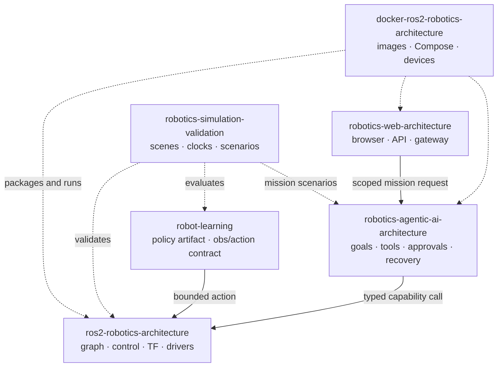

# Combining skills on one project

[← Back to README](../../README.md#results)

Each skill owns one boundary and names its companions for the boundaries next to it. For example, the ROS 2 skill says *"for container build and runtime composition, use the companion Docker architecture workflow"*. On a full-stack project, run them in the order the data flows. Each skill then builds on contracts the previous one already documented.

## Who owns what

## Example: a warehouse mission console

| Order | Skill | Prompt (short form) | Hands to the next step |
| --- | --- | --- | --- |
| 1 | `ros2-robotics-architecture` | Document the Nav2 + ros2_control graph and its action contracts. | `navigate_to_pose` action contract, TF tree, command authority |
| 2 | `robotics-agentic-ai-architecture` | Design a mission layer that calls `navigate_to_pose` and `dock` as typed tools, with operator approval for zone changes. | Tool schemas, mission state machine, approval rules |
| 3 | `robotics-web-architecture` | Design the operator console that submits missions and shows live pose and mission state. | REST and WebSocket contracts, per-robot authorization |
| 4 | `docker-ros2-robotics-architecture` | Compose the sim profile: gazebo, bringup, agent, gateway, ui. | Image graph, isolated sim network |
| 5 | `robotics-simulation-validation` | Add scenarios: blocked aisle, stale pose, gateway disconnect mid-mission. | Pass criteria, traces, regression set |

> [!TIP]
> Keep one `ARCHITECTURE.md` per repository and let each skill fill or update its own sections, and link to the others where they own the boundary. Running all five skills in one session costs context. Run them one at a time and commit between steps.
