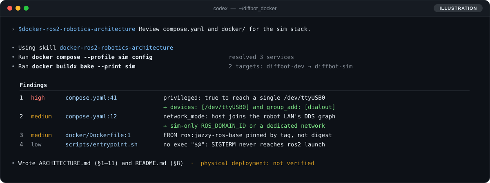
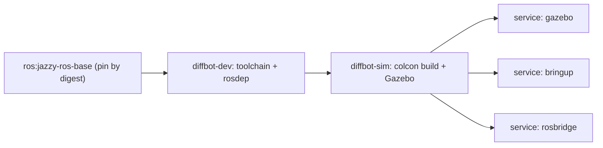
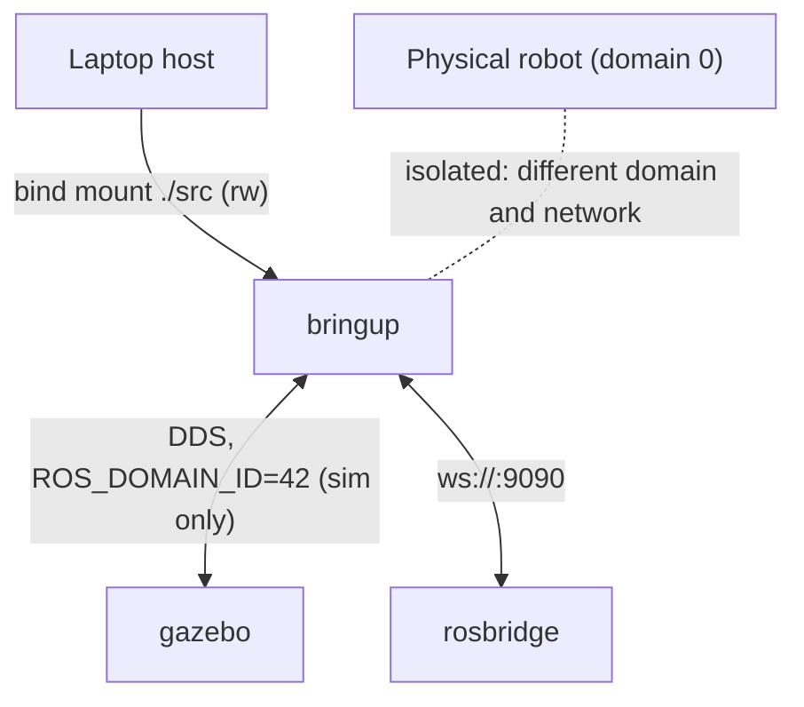

# Worked example: reviewing a Docker ROS 2 simulation stack

[← Back to README](../../README.md#results) · Skill: `docker-ros2-robotics-architecture` · Tool: OpenAI Codex CLI

> [!NOTE]
> **Illustration.** A representative example of the skill's output, not a recorded run.

## 1. Scenario

```text
diffbot_docker/
├── docker-bake.hcl        # targets: diffbot-dev, diffbot-sim
├── compose.yaml           # profiles: sim, robot
├── docker/Dockerfile      # FROM ros:jazzy-ros-base
└── scripts/entrypoint.sh  # sources the overlay, starts ros2 launch
```

The team wants the simulation stack to be reproducible in CI and safe to run on a laptop that sits on the same LAN as the robot.

## 2. Prompt

```text
$docker-ros2-robotics-architecture Review compose.yaml and docker/ for the sim stack.
Resolve the config with `docker compose --profile sim config` and the build plan with
`docker buildx bake --print sim`. Do not start containers that use host devices.
```

## 3. Outcome

<p align="center">

</p>

| # | Severity | Location | Finding | Fix | Evidence |
| --- | --- | --- | --- | --- | --- |
| 1 | High | `compose.yaml:41` | `privileged: true` only to reach `/dev/ttyUSB0` | `devices: ["/dev/ttyUSB0"]` and `group_add: ["dialout"]` | source-verified |
| 2 | Medium | `compose.yaml:12` | `network_mode: host` puts the sim on the robot LAN's DDS graph | Sim-only `ROS_DOMAIN_ID`, or a dedicated Compose network for the sim profile | source-verified |
| 3 | Medium | `docker/Dockerfile:1` | Base image pinned by tag only | Pin `ros:jazzy-ros-base@sha256:…` and record the digest in Section 10 | source-verified |
| 4 | Low | `scripts/entrypoint.sh` | Script does not `exec "$@"`, so SIGTERM never reaches `ros2 launch` | End with `exec "$@"` | runtime-verified (`docker compose stop` hung for 10 s) |

### Generated build graph (Section 2)



### Generated runtime boundary (Section 2)



## 4. What stays unverified

> [!WARNING]
> - The `robot` profile: device permissions on the onboard computer, real-time limits, and the motor-driver link. These need the robot under the team's operating procedure.
> - Multi-architecture builds (`linux/arm64`) when the CI runner has no QEMU or native arm64 builder.
