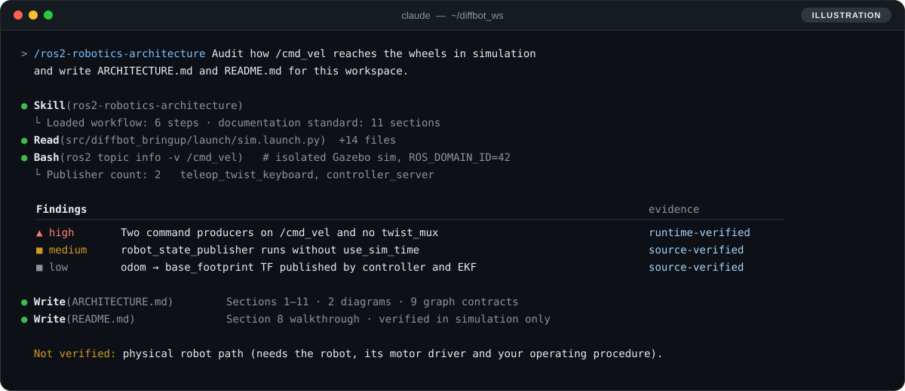
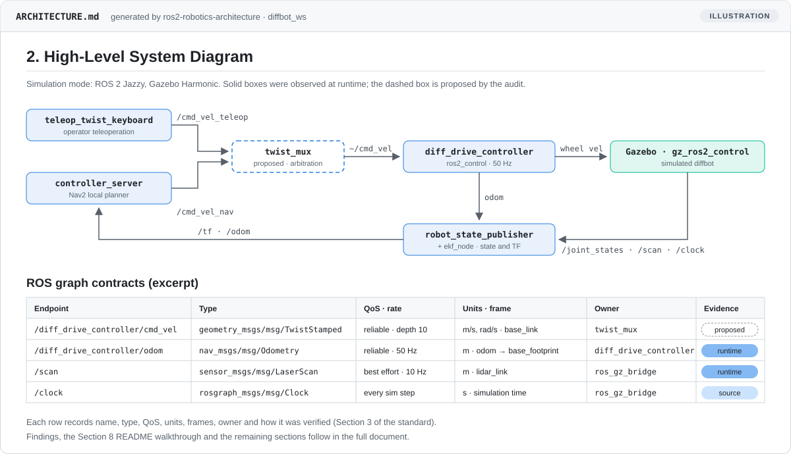
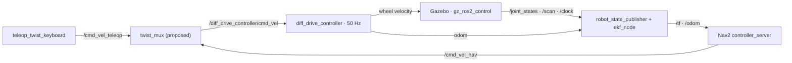

# Worked example: auditing a ROS 2 differential-drive robot

[← Back to README](../../README.md#results) · Skill: `ros2-robotics-architecture` · Tool: Claude Code (the same prompt works in Codex with `$`, in Cursor or Grok Build with `/`, and in Windsurf with `@`)

> [!NOTE]
> **Illustration.** The workspace, outputs and findings below are a representative example of what the skill produces. They were not captured from a recorded run. Replace them with your own project's evidence.

## 1. Scenario

| Item | Value |
| --- | --- |
| Robot | Small differential-drive base with a 2D lidar |
| Workspace | `~/diffbot_ws` (ROS 2 Jazzy, `ament_cmake` / `ament_python`) |
| Simulator | Gazebo Harmonic via `gz_ros2_control` and `ros_gz_bridge` |
| Control | `ros2_control` with `diff_drive_controller` at 50 Hz |
| Autonomy | Nav2 `controller_server` plus `teleop_twist_keyboard` for manual driving |
| Goal | Understand who commands the wheels, document the stack, and find integration bugs before the first hardware test |

## 2. Prompt

```text
/ros2-robotics-architecture Audit how /cmd_vel reaches the wheels in simulation and
write ARCHITECTURE.md and README.md for this workspace. Use only the isolated Gazebo
stack (ROS_DOMAIN_ID=42); do not touch the physical robot.
```

> [!TIP]
> The prompt names the **scope** (cmd_vel path), the **deliverables** (both documents), the **mode** (simulation only) and a **safety boundary** (no hardware). The skill asks for all four in Workflow step 1.

## 3. What the agent does, mapped to the workflow

| Workflow step | Agent actions in this example | Evidence produced |
| --- | --- | --- |
| 1. Identify scope | Records the revision (`git rev-parse HEAD`), ROS distro, sim-only mode, and the request for both documents. | Project identification (Section 10) |
| 2. Start with the repository | Reads `README.md`, every `package.xml`, `launch/sim.launch.py`, `config/controllers.yaml`, `urdf/diffbot.urdf.xacro`, `config/nav2_params.yaml`. | Annotated tree (Section 1) |
| 3. Map the runtime | Traces teleop → `/cmd_vel` and Nav2 → `/cmd_vel`, then controller, `gz_ros2_control`, Gazebo, and back through `/joint_states`, EKF and `/tf`. | System diagram (Section 2) |
| 4. Interface evidence | In the isolated sim: `ros2 node list`, `ros2 topic info -v /cmd_vel`, `ros2 control list_controllers`, `ros2 run tf2_tools view_frames`, `ros2 param get /robot_state_publisher use_sim_time`. | Graph contract table (Section 3), labelled *runtime-verified* |
| 5. Produce artifacts | Writes `ARCHITECTURE.md` (Sections 1–11) and `README.md` (Section 8 walkthrough). | Two documents |
| 6. Review | Re-checks package names, launch arguments and commands against the checkout. Lists the hardware path as unverified. | "Not verified" list |

## 4. Outcome

<p align="center">

</p>

<p align="center">

</p>

### Findings

| # | Severity | Finding | Location | Effect | Verify with | Evidence |
| --- | --- | --- | --- | --- | --- | --- |
| 1 | High | Two command producers on `/cmd_vel` and no arbitration | `launch/sim.launch.py`, `nav2_params.yaml` | Teleop and Nav2 overwrite each other; the robot jitters or ignores the operator | `ros2 topic info -v /cmd_vel` shows 2 publishers | runtime-verified |
| 2 | Medium | `robot_state_publisher` started without `use_sim_time:=true` | `launch/sim.launch.py:42` | TF stamped in wall time while `/clock` is sim time; Nav2 drops transforms | `ros2 param get /robot_state_publisher use_sim_time` | source-verified |
| 3 | Low | `odom → base_footprint` published by both `diff_drive_controller` (`enable_odom_tf: true`) and `ekf_node` | `config/controllers.yaml`, `config/ekf.yaml` | Competing TF authority; pose jumps | `ros2 run tf2_ros tf2_echo odom base_footprint` | source-verified |

### Generated `ARCHITECTURE.md` excerpt (Section 2)



### Generated `README.md` outline (Section 8)

1. **Overview and what you will reproduce**: drive the simulated diffbot with teleop, then send a Nav2 goal. Acceptance: the robot reaches the goal within 0.25 m.
2. **Prerequisites**: Ubuntu 24.04, ROS 2 Jazzy, Gazebo Harmonic, `rosdep`, and the exact revision.
3. **Quickstart**: `rosdep install`, `colcon build --symlink-install`, `source install/setup.bash`, `ros2 launch diffbot_bringup sim.launch.py`.
4. **Start developing**: change `wheel_separation` in `config/controllers.yaml`, rebuild, relaunch, and check `/diff_drive_controller/odom`.
5. **Reproduce the result**: pinned world, seed, goal pose, and the bag topics to record.
6. **Troubleshooting and cleanup**: missing `/clock`, controller not active, TF extrapolation errors.

### Explicitly not verified

> [!WARNING]
> - Physical robot path: motor driver, encoder polarity, real-time loop timing.
> - Hardware odometry accuracy. That needs a bench or floor test under the team's operating procedure.

## 5. Follow-up prompts

```text
Apply finding 1: add twist_mux with teleop priority over Nav2, update the launch file,
and re-run the /cmd_vel check in the isolated sim.
```

```text
/robotics-simulation-validation Add a smoke test that fails if /cmd_vel has more than one publisher
or if /clock stops advancing.
```
