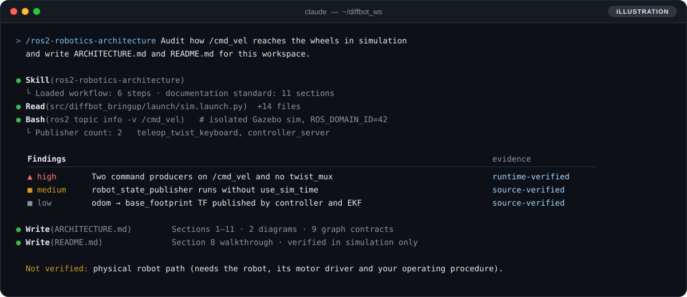

# Claude Code (and Claude.ai / Claude Desktop)

[← Back to README](../../README.md#using-the-skills) · Paths checked against the official docs on **2026-11-25**.

Claude Code is the reference client for the `SKILL.md` format. It reads every skill's `name` and `description` at start-up and loads the full workflow only when your request matches, or when you call the skill by name.

## Where skills live

| Scope | Path | Use it when |
| --- | --- | --- |
| Personal | `~/.claude/skills/<skill-name>/SKILL.md` | You want the skills in every project on this machine. |
| Project | `.claude/skills/<skill-name>/SKILL.md` | You want to commit the skills with a robot repository so the whole team gets them. |
| Nested | `<subdir>/.claude/skills/<skill-name>/SKILL.md` | A monorepo sub-tree needs its own skills. |

> [!TIP]
> Cursor, GitHub Copilot and Grok Build also read `.claude/skills/`, so one project copy serves several tools.

## Install

Clone this repository once:

```bash
git clone https://github.com/issaiass/robotics-architecture-skills ~/robotics-architecture-skills
```

**Personal scope, macOS / Linux / WSL:**

```bash
mkdir -p ~/.claude/skills
cp -r ~/robotics-architecture-skills/skills/* ~/.claude/skills/
```

**Personal scope, Windows PowerShell:**

```powershell
New-Item -ItemType Directory -Force "$HOME\.claude\skills" | Out-Null
Copy-Item -Recurse -Force "$HOME\robotics-architecture-skills\skills\*" "$HOME\.claude\skills\"
```

**Project scope** (run from your robot repository root, and copy only the skills that project needs):

```bash
mkdir -p .claude/skills
cp -r ~/robotics-architecture-skills/skills/ros2-robotics-architecture .claude/skills/
cp -r ~/robotics-architecture-skills/skills/docker-ros2-robotics-architecture .claude/skills/
```

To update, run `git pull` in `~/robotics-architecture-skills` and copy again.

## Use

| Mode | What you type | What happens |
| --- | --- | --- |
| Automatic | `Audit the ROS 2 graph of this workspace and document it.` | Claude matches the request to the `ros2-robotics-architecture` description and loads it. |
| Explicit | `/ros2-robotics-architecture Audit how /cmd_vel reaches the wheels in simulation.` | The skill loads immediately; the text after the name is your task. |
| Combined | `/docker-ros2-robotics-architecture … then use the ROS 2 skill for the graph.` | The skills point to each other at their boundaries ("use the companion … skill"). |

**Check that it loaded:** type `/` and look for the six skill names in the command list. During a run, the transcript shows a `Skill(<name>)` line when a skill activates.

## Example

```text
/ros2-robotics-architecture Audit how /cmd_vel reaches the wheels in simulation and
write ARCHITECTURE.md and README.md for this workspace. Use only the isolated Gazebo
stack (ROS_DOMAIN_ID=42); do not touch the physical robot.
```

Expected outcome: see the [worked example](../examples/ros2-diffbot-audit.md).

<p align="center">

</p>

## Claude.ai and Claude Desktop

The chat apps take skills as uploads instead of folders.

1. Zip **one** skill folder so the archive contains `ros2-robotics-architecture/SKILL.md`:

   ```bash
   cd ~/robotics-architecture-skills/skills && zip -r ~/ros2-robotics-architecture.zip ros2-robotics-architecture
   ```

   ```powershell
   Compress-Archive -Path "$HOME\robotics-architecture-skills\skills\ros2-robotics-architecture" -DestinationPath "$HOME\ros2-robotics-architecture.zip"
   ```

2. Open the app's **Skills** settings (under *Settings → Capabilities* in current builds; labels can move between versions). Make sure code execution is on, then upload the ZIP.
3. Start a chat and either name the skill or describe the task. Attach the files you want reviewed.

> [!WARNING]
> The chat apps cannot read your local checkout or run `ros2` / `docker`. Claims stay *source-verified* for the files you attach.

## Troubleshooting

| Symptom | Fix |
| --- | --- |
| The skill never activates on its own | Call it explicitly with `/skill-name`, or use words from its `description` (for example "audit", "ROS 2", "Compose"). |
| `/skill-name` is not listed | Check the path is `…/skills/<skill-name>/SKILL.md`, not `…/skills/skills/…`. Restart the session. |
| Two copies behave differently | You have the skill at personal and project scope. Keep one. |
| It writes docs but runs no `ros2` commands | No ROS 2 environment is sourced in that shell. The skill then marks contracts as *source-verified* only, which is correct behaviour. |

## Sources

- [Claude Code skills documentation](https://code.claude.com/docs/en/skills)
- [Agent Skills open standard](https://agentskills.io)
