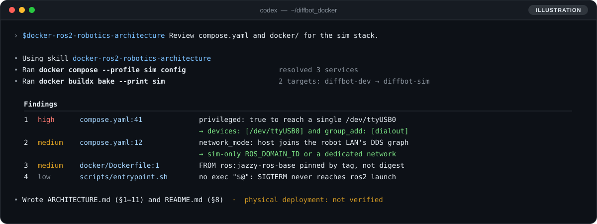

# OpenAI Codex (CLI, IDE extension) and ChatGPT

[← Back to README](../../README.md#using-the-skills) · Paths checked against the official docs on **2026-11-25**.

Codex implements the open Agent Skills format. It scans for `SKILL.md` folders, keeps only `name` and `description` in context, and loads a skill when your task matches or when you mention it with `$`.

## Where skills live

| Scope | Path | Notes |
| --- | --- | --- |
| Repository | `.agents/skills/` | Scanned in the current directory **and every parent up to the repository root**. |
| User | `~/.agents/skills/` | Available in every repository. Older Codex releases used `~/.codex/skills/`. |
| Admin | `/etc/codex/skills/` | Machine-wide, managed by an administrator. |

> [!TIP]
> `.agents/skills/` is the shared folder. Cursor, Windsurf, GitHub Copilot and Gemini CLI read it too.

## Install

```bash
git clone https://github.com/issaiass/robotics-architecture-skills ~/robotics-architecture-skills

# user scope: every repository
mkdir -p ~/.agents/skills
cp -r ~/robotics-architecture-skills/skills/* ~/.agents/skills/

# or repository scope: run from the robot repo root
mkdir -p .agents/skills
cp -r ~/robotics-architecture-skills/skills/docker-ros2-robotics-architecture .agents/skills/
```

```powershell
New-Item -ItemType Directory -Force "$HOME\.agents\skills" | Out-Null
Copy-Item -Recurse -Force "$HOME\robotics-architecture-skills\skills\*" "$HOME\.agents\skills\"
```

**Built-in installer:** Codex ships a `skill-installer` system skill. Inside Codex you can ask it to fetch skills from a repository:

```text
$skill-installer install the skills in https://github.com/issaiass/robotics-architecture-skills/tree/main/skills
```

> [!IMPORTANT]
> Restart Codex after installing so the new skills are discovered.

## Use

| Mode | What you type |
| --- | --- |
| Browse | `/skills` |
| Mention | `$docker-ros2-robotics-architecture Review compose.yaml and docker/ for the sim stack.` |
| Automatic | `Review our Dockerfiles and Compose stack for ROS 2 discovery and device access problems.` |
| ChatGPT | Type `@` and pick the skill, where skills are enabled for your workspace. |

To turn off automatic activation for a skill while keeping `$name` working, set `allow_implicit_invocation: false` as described in the Codex skills docs.

## Example

```text
$docker-ros2-robotics-architecture Review compose.yaml and docker/ for the sim stack.
Resolve the config with `docker compose --profile sim config` and the build plan with
`docker buildx bake --print sim`. Do not start containers that use host devices.
```

<p align="center">

</p>

Full walkthrough: [Docker sim-stack review](../examples/docker-sim-stack-review.md).

## Troubleshooting

| Symptom | Fix |
| --- | --- |
| `$name` autocompletes nothing | Restart Codex; it loads skills at start-up. Check the folder is `.agents/skills/<name>/SKILL.md`. |
| The skill is found in one sub-folder but not another | Repository scope is scanned **upwards** from where you launched Codex. Put the skills at the repo root. |
| Sandbox blocks `docker` or `ros2` | Approve the command or run Codex with the permissions your project allows. The skill records the check as pending instead of inventing output. |

## Sources

- [Codex: Agent Skills](https://developers.openai.com/codex/skills)
- [Build skills (ChatGPT / Codex)](https://learn.chatgpt.com/docs/build-skills)
