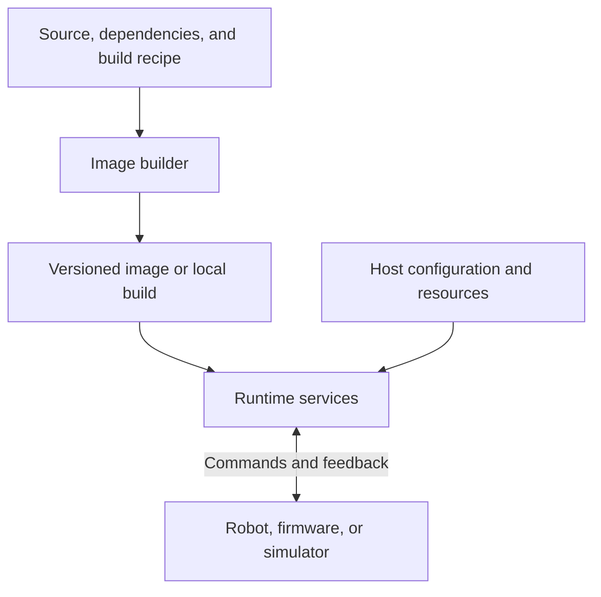

# Docker ROS 2 Robotics Architecture

## Workflow

1. Identify the task and scope. Establish the target robot or simulator, ROS distribution, host and image platforms, deployment modes, and any accelerator, device, or network requirements. For an existing repository, record the checked-out revision and inspect existing documentation.
2. Trace the build graph. Read Dockerfiles, build contexts, ignore rules, source pins, Bake or CI build definitions, and image tags. For each selected image, show what gets fetched, copied, installed, or compiled, what it inherits, and which output or digest a service consumes.
3. Trace the runtime graph. Read Compose files, overlays, environment templates, and entrypoints. Resolve the selected environment and service configuration with local tools where available. Trace mounts, users, devices, privileges, network discovery, clocks, startup, readiness, and shutdown. Treat robot-side configuration and container-side settings as independently verifiable inputs.
4. Verify with the narrowest applicable checks. Start with configuration or build-plan inspection. Use image smoke checks and an isolated simulation stack when the environment supports them. Check build output or selected image, service readiness, ROS graph and time, and where logs and results land. Preserve repository-specific commands and document physical hardware validation separately.
5. Produce the requested artifacts. For full project documentation, write or update the root `ARCHITECTURE.md` using Sections 1–11 and the root `README.md` using Section 8. Explain image contents, bind mounts, volumes, entrypoints, how to make a first code change, and how to reproduce and verify results. For an audit, give findings with locations, effects, and reproduction steps. Modify build or runtime files when implementation is within scope.
6. Review the result against selected profiles and modes. Verify links, service and image names, configuration order, result paths, and cleanup commands. Identify unverified assumptions and any tests that require another host, accelerator, or physical target. Use the native ROS 2 architecture workflow when the task also requires the robot's application-level graph or control contracts.

Keep simulation, development, CI, and physical deployment evidence attached to their actual configurations. Never infer physical readiness from an image build or simulation-only health check.

## Embedded documentation standard

Use the numbered headings below for a full project architecture. Use the README requirements in Section 8 for the public walkthrough. Mark proposed choices, source-verified facts, runtime-verified observations, and unresolved items as applicable. Link the evidence a reader needs to reproduce or review the result.

### 1. Project Structure

Include an annotated directory tree in Section 1. Start at the repository root and show `README.md`, `ARCHITECTURE.md`, the actual build and launch entry points, tests, and any documentation assets. Use verified paths for an existing checkout and label a proposed layout as such. Show where README figures and data come from. Summarize generated output paths separately when relevant.

Illustrative repository root.

```text
robot_docker/
├── README.md                  # Visual build, startup, and reproduction guide
├── ARCHITECTURE.md            # Build graph, service topology, and host boundary
├── docker-bake.hcl            # Image targets and parent dependencies
├── compose.yaml               # Default development or simulation stack
├── docker/                    # Dockerfiles
├── scripts/                   # Entrypoints and health checks
├── test/                      # Image and stack smoke checks
└── docs/
    ├── media/                # Runtime and simulator screenshots
    └── figures/              # Build and service diagrams, plots, and sources
```

| Responsibility | What to locate and record |
| --- | --- |
| Images and build graph | Dockerfiles, build contexts and ignore rules, parent images or stages, build arguments, Bake or equivalent, and the source of version and platform matrices. |
| Runtime composition | Compose files or equivalent, overlays, profiles or service selection, local configuration templates, and startup order. |
| Runtime entry points | Entrypoint scripts, ROS setup and overlay sourcing, launch commands, signal handling, supervision, health checks, and shutdown. |
| Host integration | Device and group mappings, network and DDS settings, GPU/display setup, shared memory, cgroups, time sync, and deployment prerequisites. |
| Artifacts and verification | CI definitions, image tags/digests, smoke/integration tests, and persistent and generated artifact locations. |

A change to image contents normally belongs in the build recipe. A change to how a particular deployment wires services, mounts, networks, or devices normally belongs in its runtime configuration. Follow the repository's ownership for shared scripts and configuration.

### 2. High-Level System Diagram

Document the build graph and the runtime graph separately. The build graph shows parent images, workspace build inputs, target outputs, and publication. The runtime graph shows host/container/firmware boundaries, network and IPC paths, configuration mounts, and hardware or simulator access. Replace the generic roles with the actual project components.



For each target, trace an operator or autonomy command to the subsystem that can act on it, and feedback back to its consumer. Include ROS participants outside containers when they share the graph.

### 3. Core Components

Maintain an inventory of images and runtime services. For each image, record parent, what it installs or builds, target platforms, tag or digest, and what its default command does. For each service, record its image or build target, user, launch, ROS graph role, required mounts/devices, readiness, shutdown and restart behavior.

| Role | Architecture details to record if implemented |
| --- | --- |
| Base/runtime image | ROS distro and OS, package sources, pinned dependencies, runtime user, and which images inherit it. |
| Developer or CI environment | Toolchain, underlay and overlay paths, workspace persistence, user mapping, cache boundaries, and tests or lint run. |
| Simulation | Simulator and adapter, model and scene sources, render/headless modes, clock source, ROS bridge, and objective readiness. |
| Autonomy, control, or operator tools | Package and launch entry point, interfaces, dependencies, time mode, command authority, accelerators, and behavior on failed dependencies. |
| On-robot runtime | Firmware and device access, host prerequisites, service supervision and resource policies, permissions, readiness and rollback path. |
| Bridge or external gateway | WebSocket, DDS, SDK, or other interface, network exposure, scope of graph access, and reconnect behavior. |

Explain the precedence of image defaults, runtime environment, robot configuration, launch arguments, and overlays. Record where each command or data interface is resolved into the live graph. Treat health, application readiness, and permission to send commands to actuators as separate states.

#### Robot-family considerations

| Robot family | Host/container boundaries to verify |
| --- | --- |
| Manipulator or gripper | Vendor driver location, fieldbus or SDK access, joint state and trajectory path, timing requirements, and controller and stop ownership. |
| Legged system | Policy/model artifact version, acceleration and target compute, latency and jitter budgets, estimator/contact inputs, and control loop placement. |
| Aerial robot | Autopilot/companion split, firmware link and bridge compatibility, flight-state and time/frame conversions, SITL/HIL modes, and arming authority. |
| Ground, marine, or other mobile platform | Propulsion/steering gateway, sensor and timing interfaces, supervision, and any navigation or remote-operation services. |
| Mobile manipulator or other hybrid | Resource claims across services, coordinated timing, feedback and command routing, and scope of stop and recovery. |

### 4. Data Stores

For each bind mount, volume, or external store, record host and container paths, producer, consumer, UID/GID, read/write mode, and retention or regeneration policy. Cover robot configuration, generated files, calibration, model weights, maps, simulator resources, workspaces, build caches, logs, and bags where present. Record which data survives container replacement and who owns backup or rollback. Identify which artifacts are built into the image and which are supplied by deployment.

### 5. External Integrations / APIs

Document the registry and package sources, ROS middleware and discovery, vendor or firmware protocol, device bus, graphics runtime, and remote operator integrations used. Record compatibility and ownership per interface. At graph boundaries, record ROS distro, message versions, QoS, namespace and remaps, domain/discovery settings, time source, and network direction. Describe the host configuration needed to provision devices, groups, routes, and clocks.

### 6. Deployment & Infrastructure

- Provide a matrix of host OS/engine, image OS/ROS distro, CPU architecture, accelerator runtime, target hardware and firmware, and capabilities that differ by mode.
- Describe how builds resolve their parent images and package inputs, where output images go, and how a local build is selected at runtime. Record a release tag or digest and retain the resolved runtime configuration for reproducibility.
- Document entry points, readiness dependencies, restart policy, resource limits, and where RT scheduling or other control-loop constraints are enforced if needed. Name the smoke or integration test that covers each supported path.
- Document log and diagnostic access, deployment promotion and rollback, and which steps are specific to a workstation, CI runner, simulator host, or physical robot.

### 7. Security Considerations

Inventory effective privilege, devices, capabilities, host networking and IPC, cgroup access, display sharing, bind mounts, and exposed endpoints. Record the scope and purpose of each grant. Describe who can configure or command the robot, where credentials live, and how registry, API, and remote UI access are controlled. Use scoped device grants and restrict mount and network access where the chosen runtime supports it. Document how a development or CI stack is isolated from live hardware and from command-capable ROS graphs. See [Docker host networking](https://docs.docker.com/engine/network/drivers/host/), [runtime privileges](https://docs.docker.com/engine/containers/run/#runtime-privilege-and-linux-capabilities), and [build secrets](https://docs.docker.com/build/building/secrets/).

### 8. Development & Testing Environment

1. Validate the fully resolved configuration and image/platform selections. Record how to inspect the image build plan and what output a successful build creates.
2. Build or pull the selected images, then run entry-point and dependency smoke checks. Confirm the actual ROS underlay/overlay, version and user, and check mount permissions with the intended runtime UID.
3. Run a mock or isolated simulator with the intended service set. Check clock, graph discovery, feedback rates, transforms and readiness. Exercise documented restart, shutdown and fault paths as applicable.
4. For device-dependent behavior, record separate bench/HIL/robot checks with the relevant host configuration, timing thresholds, and authorized operating procedure. Use the project-defined physical readiness checks before allowing actuation.
5. Document the tools and CI gates, preserve diagnostics on failures, and verify health from inside the service and from a realistic downstream consumer.

#### Required project README

Write a root `README.md` that a new contributor can use from a clean checkout. Open with the project goal, what the robot or stack does, and a representative result. Link to `ARCHITECTURE.md` and add a table of contents when the guide is long. Use explanatory prose alongside commands so readers understand why they are doing each step and how it connects to the result.

##### README walkthrough

Each numbered step states its purpose, the working directory and prerequisites, the exact commands or edits, what it consumes and produces, and how to check success. Include representative output and a recovery step for common errors. Label example output and record which steps were verified, where they were run, and which require a different host, simulator, or robot.

| README section | What it must contain |
| --- | --- |
| Overview and what you will reproduce | Describe the robot, scenario, expected behavior, and one demonstrable result or acceptance check. |
| Prerequisites and inputs | Give a compatibility table and identify the exact revision, dependencies, configuration, assets, and data needed for the demonstrated path. |
| Quickstart from a clean checkout | Use a numbered setup, build, launch, and verification sequence. Define every variable and mark commands that run in another shell, host, or container. |
| Start developing | Walk through one small change, identify the file to edit, explain its role, rebuild or restart the affected components, and run the relevant checks. |
| Reproduce the result | Pin the scenario, configuration, and seed when relevant. Give the command, result directory, expected logs or metrics, acceptance tolerances if applicable, and the procedure to regenerate figures. |
| Troubleshooting and cleanup | Pair common symptoms with diagnostics and fixes. Give the shutdown and cleanup commands and identify any data they affect. |

##### Visual and technical evidence

- Use a representative robot, simulator, or runtime screenshot when available. Add alt text, a caption describing what to look for, and the scenario or revision where it was captured. Label illustrations and placeholders explicitly.
- Use a graph, figure, or infographic to explain a relationship the reader needs to follow, such as data flow, startup order, or the development loop. Use an annotated screenshot for UI checkpoints where useful. Keep diagrams close to the relevant steps.
- Use tables for exact comparisons such as compatibility, configurations, or expected outputs. Include plots when results depend on measured data. Label axes and units, record the data and run conditions, and link the commands or scripts that generate them.
- Include equations when they explain a calculation, controller, or metric. Define symbols, units, and assumptions, and connect the equation to the relevant configuration or result.
- Store repository-owned media and reproducible figure sources under documented paths such as `docs/media/` or `docs/figures/`. Use working relative links and preview the README on the target renderer. Identify the source and license for third-party material.

For a Docker project, show how to inspect the resolved Compose configuration and select a build or pull path. Explain what each selected image builds, which repository files are copied or installed into it, what is mounted or supplied at runtime, and what each entrypoint starts. Walk through image selection, startup, health checks, logs, ROS graph inspection, artifact retrieval, and teardown. In the development walkthrough, show how a source edit reaches the running service and when to rebuild an image or restart a service. Document the host permissions, device mappings, and other requirements for physical deployment separately when supported.

### 9. Future Considerations / Roadmap

List confirmed plans with issue or release references. Track proposed changes separately. Revisit this document for changes to parent images, target architectures, Compose and runtime capabilities, ROS distributions, device privileges, middleware, artifact ownership, and hardware or simulation timing.

### 10. Project Identification

| Field | Required record |
| --- | --- |
| Project and owner | Project name and maintaining team or support link. |
| Source baseline | Repository and exact commit or tag, review date, and deployment configuration baseline. |
| Images and targets | Registry or local outputs, tag/digest policy, architecture matrix, and supported deployment modes. |
| Evidence | Source links and known CI, simulation, and physical validation results or gaps. |

### 11. Glossary / Acronyms

| Term | Meaning |
| --- | --- |
| Buildx / Bake | Docker build tooling and declarative definitions for build targets and their inputs. |
| GHCR / digest | GitHub Container Registry and an immutable identifier for a particular image or manifest. |
| Compose / overlay | Runtime service definitions and additional configuration that modifies those definitions. |
| DDS / RMW / IPC | Data Distribution Service, the ROS middleware interface, and inter-process communication. |
| UID/GID | Numeric user and group identities that affect host mount/device access. |
| SITL / HIL | Software-in-the-loop and hardware-in-the-loop validation. |
