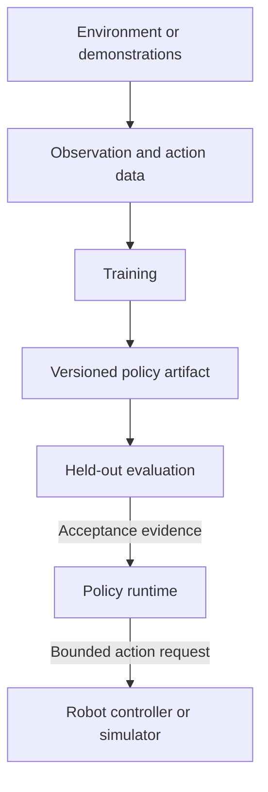

# Robot Learning

Use this skill to develop a learned policy that turns observations and optional goals into actions. Support simulation, recorded demonstrations, and approved physical data workflows. Select learning methods, models, and runtimes from data, task, and compute constraints. Use the companion simulation skill to validate scenes and test fidelity, and the agentic AI skill to orchestrate higher-level missions that call policy-backed capabilities.

## Workflow

1. Establish the task, deployment context, data sources, success criteria, baseline, and evaluation split. Inspect the environment, data schemas, training configs, policy and preprocessing code, evaluation, and deployment artifacts. Identify proposals and missing evidence.
2. Trace raw observations through alignment and preprocessing into policy inputs, and trace policy outputs through postprocessing to the receiving controller. Check coordinate frames, units, timing, action bounds, reset behavior, and compatibility across training, evaluation, and inference.
3. Choose the learning method and simplest meaningful baseline. Validate the environment or a batch of data first. Run a small training smoke test before allocating substantial compute. Compare the candidate against the baseline using a fixed evaluation protocol.
4. Record repeatable training and evaluation evidence, plus limits of observed generalization. Define checkpoint promotion, inference constraints, and behavior on invalid inputs, stale observations, or missed deadlines. Exercise staged evaluation in the supported environment under the project's operating procedure.
5. Produce or review the requested artifacts. For full documentation, write or update `ARCHITECTURE.md` using Sections 1–11 and `README.md` using Section 8. For implementation, include changes to the pipeline and checks within scope. For review, cite the files and runtime evidence behind findings.

## Embedded documentation standard

Use the following 11 sections adapted from [architecture.md](https://architecture.md/). Note which learning paths are implemented, proposed, or inapplicable.

### 1. Project Structure

Show an annotated tree derived from the checkout, or label a proposed layout. Locate environment, datasets and splits, training and evaluation entry points, configs, checkpoints, exports, tests, and reports. Identify how externally stored artifacts are retrieved and verified.

```text
robot-learning/
├── README.md                 # Reproduce training, evaluation, and inference
├── ARCHITECTURE.md            # Data, policy, and runtime contracts
├── environments/             # Task, reset, reward, and episode logic
├── data/                     # Schemas, manifests, and split definitions
├── configs/                  # Versioned learning and evaluation settings
├── policies/                 # Model, normalization, and action conversion
├── scripts/                  # Train, evaluate, export, and run entry points
├── tests/                    # Data, environment, and inference checks
└── docs/figures/             # Rollout visuals, plots, and generation sources
```

### 2. High-Level System Diagram

Show sources, policy artifacts, evaluation and deployment. For online learning, include the environment action and observation loop. For offline learning, label the dataset split and where held-out data enters evaluation.



### 3. Core Components

| Component | What to document |
| --- | --- |
| Task and environment | Goal and success criteria, reset and initialization, state and action spaces, sensors and actuation, and task termination versus external truncation where relevant. |
| Observation and action contract | Shapes, dtypes, modality, channel and joint order, units, frames, normalization, timestamps, observation history, action duration or chunking, and the controller interface. |
| Data pipeline | Collection and filtering, calibration and temporal alignment, episode boundaries, data quality, versioning, and train, validation, and test independence. |
| Training | Method, model or policy, objective, configs, compute budget, baselines, random seeds, artifact lineage, and checkpoint selection. |
| Evaluation and inference | Held-out scenarios, metrics, failure modes, preprocessing and output parity, latency, runtime supervision, and promotion criteria. |

For **reinforcement learning**, specify reward terms, scaling, rollout and update settings, reset distribution, and how learning handles termination and truncation. Check for unintended reward incentives. For **imitation or offline learning**, specify data provenance and coverage, synchronization, splits by the appropriate grouping, and how rollout errors are evaluated. For **vision-language-action**, specify image preprocessing, instruction encoding, history, action representation and horizon, and held-out task or instruction evaluation. Combine these requirements when the pipeline uses multiple methods.

### 4. Data Stores

Record dataset and modality schemas, provenance, access and license, episode and split manifests, preprocessing statistics, checkpoints, exports, evaluation traces, and lineage. Fit data-derived transformations on training data and track the split boundaries used to prevent leakage. Identify authoritative versions and reproduction or transfer procedures.

### 5. External Integrations / APIs

Describe simulators, robot and sensor APIs, data and experiment stores, model runtimes, and controllers used by the policy. Record sample rates, schemas, units, frames, normalization, action type and synchronization at every critical boundary. Identify how missing or stale inputs and invalid policy outputs are reported to the caller or supervisor.

### 6. Deployment & Infrastructure

Document training and inference dependencies, compute and storage, artifact versioning, export settings, inference cadence, and latency budgets. Check equivalence between training-time and exported preprocessing, normalization, and action decoding. Describe staging, promotion, monitoring, and rollback by environment. Keep policy inference and bounded command handling separate in the architecture diagram where they have distinct owners.

### 7. Security Considerations

Record data and checkpoint provenance, permissions, secrets, and scope of robot access. Document where runtime code validates observation freshness and action bounds, and how deadline misses, fallback, and operator override are handled. Keep training, replay, and simulated trials isolated from live command targets. Use the robot project's approved procedure for physical evaluation.

### 8. Development & Testing Environment

Require a root `README.md` linked to `ARCHITECTURE.md`. From a clean checkout, identify prerequisites, dependency and dataset revisions, exact commands and working directories, what each step builds or loads, sample outputs, artifacts, and common recovery steps.

1. Validate the environment or data and run a minimal training job. Check observation and action shapes, reset or episode handling, and creation of a loadable checkpoint. Walk through a small change to a config, objective, or evaluation scenario and how to test it.
2. Reproduce one complete train-to-evaluation run. Pin configs, datasets, environment versions, seeds where supported, policy artifacts, and hardware used for comparison. Explain expected runtime or compute needs when known, result files, and how to rerun evaluation without training again.
3. Compare the baseline and candidate under the same protocol. Report task success and task-specific failure rates, relevant constraint violations, latency, seed and episode counts, and variability. For RL, keep return and task success separate. Avoid selecting checkpoints on the held-out test set. Explain what remains unverified in each deployment mode.
4. Include actual screenshots or rollout figures when available, pipeline diagrams or infographics, tables for configs and evaluation, and reproducible plots with units and labeled axes. Define equations when describing reward terms, metrics, or normalization. Link data and generation commands and label illustrative results.

### 9. Future Considerations / Roadmap

Record coverage gaps, observed failure modes, dataset or interface changes, and tradeoffs. Identify evaluation criteria before switching models, policies, or deployment targets.

### 10. Project Identification

Record repository, owner, reviewed revision, task and robot scope, learning method, dataset and policy versions, evaluation mode, and evidence gaps.

### 11. Glossary / Acronyms

Define project terms such as episode, rollout, policy, return, behavior cloning, termination, truncation, and vision-language-action.

## Optional implementation reference

[Gymnasium’s time-limit guide](https://gymnasium.farama.org/tutorials/gymnasium_basics/handling_time_limits/) illustrates termination and truncation semantics. Use the chosen environment and training stack documentation to verify the exact contract.
