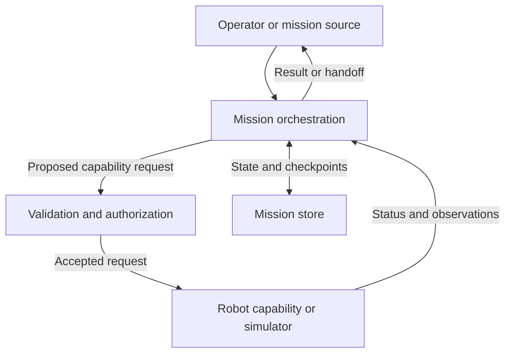

# Robotics Agentic AI Architecture

Use this skill for the mission layer of a robotics system. Accept a goal, ground it in the robot's current state, select supported capabilities, verify their outcomes, and recover or escalate. Apply the same architecture to a coded state machine, a workflow engine, a model-driven planner, or a hybrid. Choose multi-agent coordination only when the project has a concrete need for distinct roles, capabilities, or execution contexts.

## Workflow

1. Establish the use case, robot capabilities, environment, operator roles, success criteria, and limits. Inspect the repository revision, entry points, state schemas, tool adapters, policy and configuration, tests, and deployment definitions. Separate implemented behavior, proposed design, and unresolved decisions.
2. Compare a deterministic baseline with the proposed agent workflow. Identify where model reasoning adds value and where state transitions, authorization, and limits belong in explicit code. Trace a mission from goal intake to completion, interruption, or operator handoff.
3. Trace a tool call from proposed intent through validation and dispatch to observed outcome. Record the owner of command authorization, robot mode, and command arbitration. Use approved robot capabilities with typed contracts. Keep actuator control and physical operating limits within the robot stack.
4. Define the development lifecycle. Build a minimal mission, test it against representative tasks and failure cases, release a versioned configuration with acceptance gates, and use monitored failures to add regression scenarios. Run authorized mock or isolated simulation checks when available. Record source evidence, runtime evidence, and pending checks separately.
5. Produce or review the requested deliverables. For full documentation, write or update root `ARCHITECTURE.md` using Sections 1–11 and root `README.md` using Section 8. For an audit, cite files, effects, and verification steps. Preserve existing integrations and make implementation changes within the requested scope.

Use the ROS 2, Docker, and robotics web architecture skills for their respective boundaries when relevant. The agent architecture owns mission decisions, tool contracts, state and recovery, and evaluation.

## Embedded documentation standard

Adapt the following 11 sections from [architecture.md](https://architecture.md/). Link important claims to source, a versioned configuration, or measured evidence. Mark capabilities and deployment modes that do not apply.

### 1. Project Structure

Include an annotated tree from the actual checkout. Label proposed layouts. Show the executable entry point, mission logic, schemas, prompts and model configuration when used, capability adapters, authorization policy, test fixtures, evaluation and trace locations, and developer documentation.

```text
robotics_agent/
├── README.md                  # Setup, first change, and repeatable missions
├── ARCHITECTURE.md             # Mission state, authority, and integration
├── src/
│   ├── orchestration/         # Planning and mission transitions
│   ├── capabilities/          # Typed robot and simulation adapters
│   ├── policy/                # Tool authorization and approval rules
│   └── state/                 # Mission state, checkpoints, and reconciliation
├── contracts/                 # Goals, observations, tool calls, and results
├── config/                    # Mode, budgets, and model settings if used
├── evals/                     # Versioned scenarios and scoring criteria
├── tests/                     # Unit, contract, integration, and mission tests
└── docs/figures/              # Mission diagrams, screenshots, and plots
```

### 2. High-Level System Diagram

Show the actual goal, observation, command, and outcome flows. Mark the agent-to-robot trust boundary, state persistence, approval points, and stop or handoff paths. For long-running missions, add a state or sequence diagram showing checkpoints and recovery after interruption. This generic flow is an example.



### 3. Core Components

| Component | What to document |
| --- | --- |
| Goal intake and grounding | Goal schema, robot identity, current observations, freshness checks, and how to handle ambiguous or contradictory input. |
| Planner and orchestration | Planning strategy, transitions, conditions for replan or termination, step and time budgets, and where model reasoning is used. |
| Capability registry and adapters | Typed inputs and results, units and frames, preconditions, side effects, timeout, cancellation, acknowledgments, and how completion is verified. |
| Authorization and oversight | Tool permissions by mode and robot, policy ownership, approval or operator takeover, and behavior on denied or unavailable actions. |
| State and recovery | Checkpoint boundaries, mission identifiers, action status, resumption, and reconciliation of active and uncertain requests. |
| Evaluation and telemetry | Outcome events, trace correlation, test doubles, scenario execution, and scoring. |

### 4. Data Stores

Identify the source of truth for goals, robot observations, mission state, command records, approvals, traces, and optional retrieval memory. Define retention, provenance, access boundaries, and schema migration. Record what survives restart and which data can be replayed in isolation. Reconcile a checkpoint with the robot or gateway before resuming. For requests with uncertain outcomes, determine their status using durable identifiers and the adapter's documented retry or deduplication contract.

### 5. External Integrations / APIs

Document operator clients, robot middleware, vendor controls, model providers, retrieval services, and simulator endpoints where applicable. For each capability, record request and result schemas, target identity, access scope, preconditions, observations, clock or freshness semantics, and separate acceptance and completion signals. Bind approvals to the relevant action and target, and document their validity and how they are invalidated. Record retry, timeout, cancellation, and failure propagation per integration.

### 6. Deployment & Infrastructure

Describe process placement, supported modes, state store, target isolation, environment configuration, rollout gates, and rollback. Version the orchestration, prompts, tool schemas, models, and evaluation fixtures used for a release. Define monitoring for mission completion, tool failures, latency, retries, operator escalations, and any model resource or cost budgets. Use attributable mission traces to identify regressions and convert representative failures into sanitized evaluation cases.

### 7. Security Considerations

Identify trust boundaries for operator input, retrieved content, observations, and tool outputs. Treat them as data inputs and enforce authorization outside the model. Document allowed capabilities, credential scopes, input validation, robot and session binding, audit logging, and data redaction. Show how mode checks and robot-side interlocks remain in force during retries, reconnects, and operator takeover. Keep mock, replay, and simulation command targets isolated from physical robots.

### 8. Development & Testing Environment

Require a root `README.md` linked to `ARCHITECTURE.md`. Walk from clean checkout through setup, launch, the first development change, execution, result verification, troubleshooting, and cleanup. Explain why each command runs, its working directory, expected output, and what it builds or starts. Give exact repository-specific commands, dependency and model versions where applicable, and record any prerequisites and checks still awaiting verification.

1. **Build.** Provide a minimal mission on a mock or isolated simulator. Pin the scenario, robot configuration, tool schemas, model or policy settings, and seed where supported. Document a representative change to a goal, rule, tool contract, or evaluation.
2. **Test.** Include planner and policy tests, tool contract tests, and an end-to-end mission. Cover success, ambiguous goals, stale observations, unavailable tools, denied requests, timeout or cancellation, restart with an uncertain action outcome, and operator handoff as applicable. Specify expected decisions, permitted effects, and final mission state.
3. **Deploy.** Record the target mode, evaluation gate, known limits, and steps to promote or roll back a version. Document physical deployment and verification separately where supported.
4. **Monitor.** Show where to find traces and results. Compare versions on the same scenario set using task success, verified completion, incorrect or denied tool attempts, recovery, latency, and cost where relevant. Record run counts and variability for nondeterministic components. Treat simulator success as evidence for that configuration.

Use annotated screenshots of actual runs when available, workflow or state diagrams, and tables for settings and pass criteria. Include plots for measured results and equations when they clarify a metric. Label illustrative assets, link visual and data sources, and include regeneration steps for measured evidence.

### 9. Future Considerations / Roadmap

Separate confirmed work from proposals. Identify the affected contract, owner, tradeoff, evaluation needed, and compatibility plan. Revisit the architecture when changing tool authority, state semantics, model or provider, supported robot capabilities, or deployment mode.

### 10. Project Identification

Record project, repository, owner, reviewed revision, supported environments, mission modes, integration versions, verification status, and open evidence gaps.

### 11. Glossary / Acronyms

Define project terms such as mission, capability, observation freshness, checkpoint, reconciliation, approval, accepted versus completed action, and operator handoff.

## Design references

Use these sources for design principles and examples. Select the implementation framework according to project requirements. For framework-specific behavior, verify against the relevant version of the upstream repository or official documentation.

- [architecture.md](https://architecture.md/) provides the document structure.
- [The Agent Development Lifecycle](https://www.langchain.com/blog/the-agent-development-lifecycle) informs the build, test, deploy, and monitor cycle.
- [Agentic Engineering](https://www.langchain.com/blog/agentic-engineering-redefining-software-engineering) provides examples of iterative evaluation and observability in agent development.
- [LangGraph architecture diagram](https://architecturediagram.ai/blog/langgraph-architecture-diagram) illustrates how to draw conditional routing, checkpoints, and human pause points.
- [GitDiagram view of LangGraph](https://gitdiagram.com/langchain-ai/langgraph) serves as a navigation aid. Verify implementation details against the [LangGraph repository](https://github.com/langchain-ai/langgraph).
- [LangChain GitHub organization](https://github.com/langchain-ai) provides optional implementation examples.
