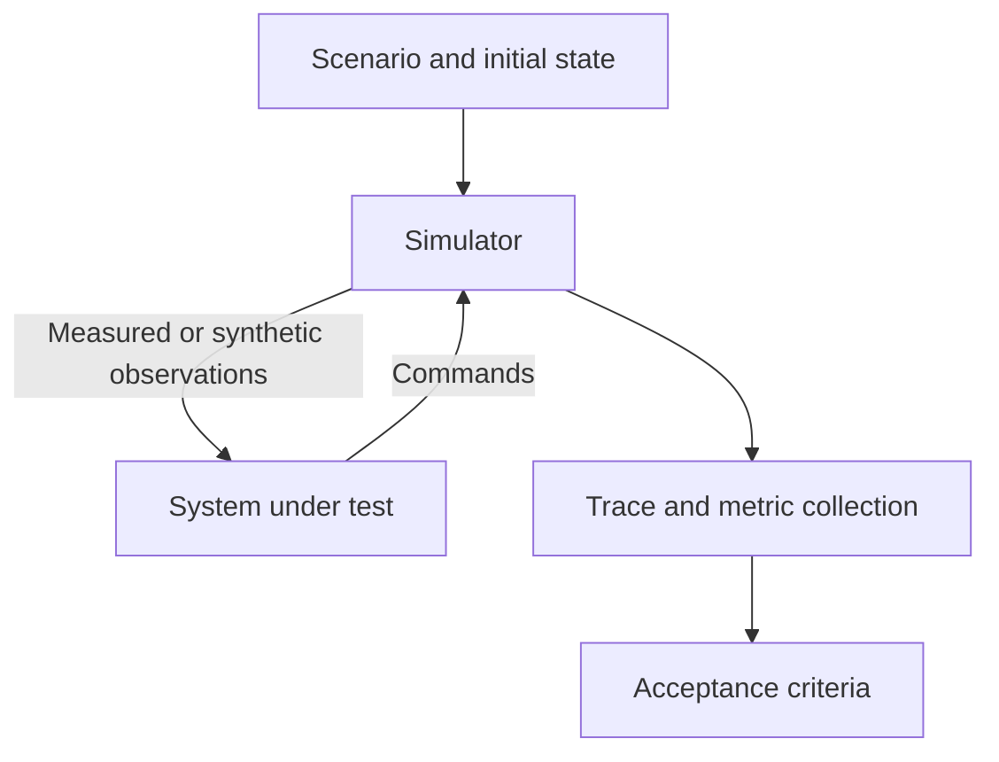

# Robotics Simulation & Validation

Use this skill for simulation environments and the evidence they produce. Select an engine and backend from the project requirements or existing repository. Apply the same workflow to engine-native tools and middleware integrations. Use the companion robot learning skill for policy training and evaluation, and the ROS 2 and Docker skills when those layers are in scope.

## Workflow

1. Establish the claim to validate, the target behavior, relevant conditions, baseline, pass criteria, and evidence needed. For an existing project, inspect its revision, model and scene sources, configs, launch code, adapters, tests, and prior reports. Label proposals and assumptions.
2. Establish the scene and the simulation contract. Trace actuator commands and sensor feedback across the engine boundary. Check model provenance, units and frames, clocks, rates, step order, initial conditions, reset behavior, and differences between the simulator and target.
3. Define a baseline scenario and relevant variations. Run the smallest supported smoke test first. Confirm the robot spawns, the clock advances, observations are valid, and reset restores the expected state. Then run the selected regression scenarios and collect metrics and diagnostic artifacts.
4. Report separately what was inspected, executed in mock or software-in-the-loop, verified in simulation, or checked with hardware. Compare with hardware data where available and document the conditions and gaps. Keep simulated commands isolated from live devices.
5. Produce the requested artifacts. For full documentation, write or update root `ARCHITECTURE.md` using Sections 1–11 and root `README.md` using Section 8. Build or modify simulation assets and tests when implementation is in scope. For an audit, report findings with paths, evidence, and verification steps.

## Embedded documentation standard

Use the following 11 sections adapted from [architecture.md](https://architecture.md/). Describe each simulator or test backend actually used, and mark inapplicable sections with a reason.

### 1. Project Structure

Include an annotated tree from the checkout or label a proposed layout. Locate source and generated models, scenes, adapters, executable entry points, tests, scenario definitions, baseline results, and figure sources. This example is illustrative.

```text
robotics_sim/
├── README.md                 # Setup, first change, and repeatable experiment
├── ARCHITECTURE.md            # Runtime, fidelity, and validation contracts
├── models/                   # Robot, components, and asset manifests
├── scenes/                   # Worlds, fixtures, and environment assets
├── config/                   # Physics, rates, rendering, and sensor settings
├── src/adapters/             # Engine, controller, and middleware integration
├── scenarios/                # Initial conditions, stimuli, and expected outcomes
├── tests/                    # Smoke, scenario, reset, and regression checks
└── docs/figures/             # Annotated visuals, plots, and generation sources
```

### 2. High-Level System Diagram

Draw the real system boundary and label command and observation paths, time source, step order, and evidence collection. Draw separate mode diagrams where the simulator and physical test paths differ.



### 3. Core Components

| Component | What to document |
| --- | --- |
| Model and environment | Source and version, units, frames, mass and inertia, collision shapes, kinematic constraints, asset conversion and licensing, as applicable. |
| Physics and timing | Engine version, timestep, substeps and solver settings, contact and friction assumptions, controller cadence, wall time versus simulated time, and sync or stepping policy. |
| Sensors and actuation | Frame and calibration provenance, rates, latency, noise, limits, and how observations and actions cross the adapter. |
| Scenarios and runner | Starting conditions, seed sources, parameter sets, reset and termination, inputs, execution modes, and timeout behavior. |
| Evaluation and observability | Metrics, traces and recordings, failure classification, baselines, and thresholds. |

### 4. Data Stores

Document where models, source assets, manifests, calibration inputs, scenario fixtures, logs, sensor samples, metrics, baselines, and visual outputs are stored. Record formats, versions, and regeneration or retention. Tie artifacts to a run ID, config, and source revision.

### 5. External Integrations / APIs

Describe applicable simulators, controllers, middleware, sensor pipelines, visualization and logging interfaces. Record message or array contracts, units, frames, clock ownership, control and sensor rates, and failure behavior. Document exactly what a scenario tests in each mode, including behavior mocked by adapters.

### 6. Deployment & Infrastructure

Record OS, engine and asset versions, run mode and compute or rendering requirements. Provide separate launch paths where GUI, headless CI, replay, software-in-the-loop, or hardware-in-the-loop differ. Document resource limits and CI artifacts. Track the compatibility impact of changing engine, solver, or asset versions.

### 7. Security Considerations

Document access to external assets, hardware interfaces and networks, configuration secrets, and permissions for connected systems. Show how virtual and replayed commands remain isolated from physical targets. Identify the project's operating procedure and authority for any physical or HIL evaluation.

### 8. Development & Testing Environment

Require a root `README.md` linked to `ARCHITECTURE.md`. Include prerequisites, exact setup and run commands, execution directories, why the steps matter, expected observations, one small development change, troubleshooting and cleanup.

1. Reproduce a baseline from a clean checkout. Pin the scene, model revisions, engine settings, target mode, scenario inputs, seeds where supported, and duration. Explain what each command builds or loads. Include one smoke check and its expected output.
2. Run representative scenario tests. State inputs, pass criteria, thresholds with units, expected traces, and where results are written. Cover timing, reset, and capability boundaries. Exercise relevant sensor or actuator faults and record behavior in the isolated environment.
3. Compare against a baseline using the same scenarios and settings. Record repetitions and variability where needed. For fidelity claims, compare synchronized observations against reference data under matched conditions and state the remaining gaps. Record actual run status separately from planned verification.
4. Regenerate evidence. Use screenshots or figures of actual runs when available, a diagram or infographic, tables for exact settings and acceptance criteria, and plots with units and data sources. Use equations when defining metrics or error measures. Label illustrative material and give commands to recreate the results.

### 9. Future Considerations / Roadmap

Record fidelity limits, known unsupported features, candidate scenarios, and upcoming changes. Link each to the claim it affects and the evidence needed before relying on it.

### 10. Project Identification

Record repository, owner, revision and date, simulator and robot configurations, validation scope, and verified or unverified test modes.

### 11. Glossary / Acronyms

Define project-specific terms, including timestep, control period, real-time factor, fidelity, and software- and hardware-in-the-loop where applicable.

## Optional engine references

Map the concepts to the chosen engine. [MuJoCo modeling](https://mujoco.readthedocs.io/en/stable/modeling.html) illustrates model and physics configuration. [Isaac Sim documentation](https://docs.isaacsim.omniverse.nvidia.com/latest/) illustrates USD scenes, robot assets, sensors, and integrations. Verify options against the engine version actually in use.
