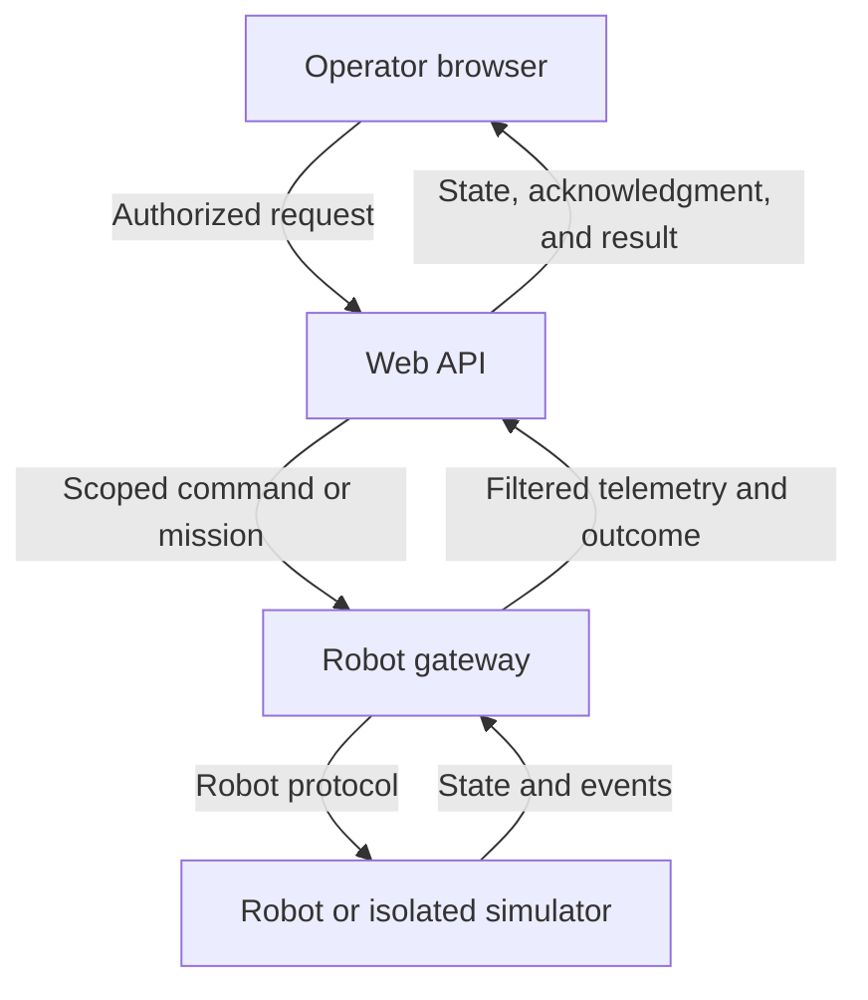

# Robotics Web Architecture

Use this workflow with any robot, web stack, robotics middleware, or deployment model. Treat read-only monitoring, mission dispatch, and direct control as different operating modes with different contracts. Apply only the modes supported by the project.

## Workflow

1. Establish the requested scope, operator roles, robot or fleet targets, supported environments, and intended web capabilities. For an existing project, read its documentation, manifests, routes, API schemas, environment examples, gateway configuration, deployment definitions, and tests. Record the repository revision and distinguish implemented behavior from proposals.
2. Trace a telemetry or video sample from producer to browser and a command or mission request from operator to robot, when supported. Identify process, network, and trust boundaries. Capture ownership, schema, transport, timing, and failure behavior at each boundary.
3. Check the actual integration. Compare browser behavior, backend authorization, and the robot-side contract against source. Verify by running tests and a mock or isolated simulator when available. Identify evidence separately for static review, mock, simulation, and physical deployment. Use representative read-only checks for live environments unless execution is authorized and covered by the project's operating procedure.
4. Produce the requested deliverables. For full project documentation, write or update root `ARCHITECTURE.md` using Sections 1–11 and root `README.md` using Section 8. For a review, report findings with paths, impact, and verification steps. Make implementation changes when requested.
5. Review both documents against the source and the selected environment. Check paths, links, route and event names, source references, commands, expected results, and acceptance criteria. Record any configuration assumptions and checks that still need runtime or hardware evidence.

Use the companion ROS 2 skill for the internal robot graph and the Docker skill for image and Compose details when the project uses those technologies. Link their project documents where they own a boundary.

## Embedded documentation standard

Adapt the following 11 sections from [architecture.md](https://architecture.md/). Keep the original numbering for a full architecture. Record why a section is inapplicable where appropriate. Cite repository files, interface definitions, or measured runs for important claims.

### 1. Project Structure

Include an annotated directory tree derived from the checkout. For a new design, label the proposed layout. Show the README, architecture, manifests, build and startup entry points, frontend, services, gateway, shared contracts, tests, and visual assets where they exist. Identify generated clients and the source schema used to regenerate them. The tree below is illustrative.

```text
robotics_web/
├── README.md                  # Visual setup, development, and reproduction
├── ARCHITECTURE.md             # System boundaries, contracts, and operations
├── apps/
│   ├── operator-ui/           # Browser screens and data clients
│   └── api/                   # Sessions, authorization, and mission API
├── services/
│   └── robot-gateway/         # Robot protocol and message translation
├── contracts/                 # Versioned API, event, and command schemas
├── environments/              # Mock, simulation, and deployment configuration
├── tests/                     # Contract, UI, and integration scenarios
└── docs/
    ├── media/                 # Screenshots and walkthrough images
    └── figures/               # Diagrams, plots, and reproducible sources
```

### 2. High-Level System Diagram

Show actual processes and trust boundaries. Label telemetry and command directions, transports, and the role of simulation. Draw separate diagrams for large flows or modes with different boundaries. Use this generic flow only as a starting point.



### 3. Core Components

| Component | What to document |
| --- | --- |
| Browser application | Operator views, target selection, permissions, state ownership, live/replay cues, stale data, disconnected and reconnecting UI states, and how requests are confirmed or reported. |
| Application backend | API and event flow, sessions, per-robot access control, routing, mission lifecycle, acknowledgments, history, and audit events. |
| Robot or fleet gateway | Protocol translation, namespace and robot identity mapping, transport behavior, health and command timeout ownership, and where authority passes to the robot. |
| Telemetry or media | Stream types, timestamps and clock domains, sampling or rate limits, subscriptions, buffering, dropped data, client resync, and media paths if present. |
| Mock, simulator, or replay | How the environment is selected and what behavior it can demonstrate. Document any capability differences between the test environment and the physical target. |

### 4. Data Stores

Map persisted and ephemeral data, including telemetry, mission state, maps, logs, media, sessions, and audit events if used. For each, document the producer, source of truth, identifier scheme, retention, access policy, and backup or replay procedure as applicable. Identify timestamps, schema versions, and the run or scenario metadata needed for reproduction.

### 5. External Integrations / APIs

List the browser-facing and robot-facing contracts with their owners. Record routes or event names, schema versions, authentication and authorization, robot identity, units and frames, timestamps, and error or reconnect behavior. Document protocol adapters when used, including ROS 2, vendor APIs, fleet APIs, or simulation interfaces.

For command-capable systems, document who can send commands, how the target is bound to the session, what acknowledgment means, and how completion or rejection is delivered. Specify handling for stale commands, duplicate requests, concurrent operators, timeouts, and loss of connectivity where applicable. Document the policy in force for retries after reconnect.

### 6. Deployment & Infrastructure

Show browser hosting, service processes, gateway placement, internal and external network paths, session and secret configuration, and environment-specific dependencies. Record supported platforms, release and rollback procedures, health checks, and observability for API errors, dropped streams, gateway disconnects, and command outcomes. Give the supported mock or simulation launch path for local development.

### 7. Security Considerations

Document identity, role and per-robot permissions, credential handling, transport protection, auditability, and the failure boundaries between browser, backend, gateway, and robot. Verify server-side authorization for both subscriptions and commands. For WebSockets, document origin checks, session lifetime, and message-level authorization as applicable. See the [OWASP WebSocket Security Cheat Sheet](https://cheatsheetseries.owasp.org/cheatsheets/WebSocket_Security_Cheat_Sheet.html).

Document the owner of command arbitration and the robot's response to stale requests or loss of connectivity. Describe the authority and limits of UI controls and the robot-side interlocks independently. Show how development, replay, and simulation are isolated from physical command targets.

### 8. Development & Testing Environment

Require a root `README.md` that takes a new contributor from a clean checkout to a verified result. Link it to `ARCHITECTURE.md`. For each step, explain the reason for the action, the working directory and process, exact commands, inputs, files or artifacts created, expected output, and how to recover from common errors.

1. Describe the project and what the reader will reproduce. Include applicable runtime versions, dependencies, environment variables, supported fixtures, and a representative result.
2. Install dependencies and explain what builds or bundles, which inputs are read, and where outputs land. Show which processes run in each shell, service, or container. Provide sample configuration with safe placeholder values.
3. Start the browser app, backend, gateway, and mock or simulation target as applicable. Show the URL or entry point, expected UI state, and evidence that data reached the browser. Include physical deployment prerequisites separately when supported.
4. Walk through one small development change. Identify the file to edit, how the change reaches the UI or service, whether a rebuild or restart is needed, and the test that verifies it.
5. Reproduce a representative scenario such as telemetry replay, reconnect after stream loss, or a mock mission submission. Pin the revision and fixture. Record exact commands, expected output and pass criteria, where logs or plots are saved, and cleanup steps.
6. Document relevant contract, component, and end-to-end checks. Exercise stale telemetry, reconnect, unavailable gateway, and schema errors. For command-capable systems, cover invalid or unauthorized requests, incorrect robot selection, duplicate delivery, and timeout behavior using mock or simulation where possible. Identify what was run and what requires a different environment.

Use descriptive prose plus visual evidence. Include labeled screenshots of the actual UI or simulator when available, a diagram or infographic for system or workflow context, and tables for exact settings and expected results. Use labeled plots for measured behavior such as latency and equations when they explain a metric or calculation. Define units and inputs, link figure sources and regeneration steps, label illustrative assets, and verify relative links and captions.

### 9. Future Considerations / Roadmap

Separate confirmed plans and design proposals. Record the affected contract, owner, reason, and validation needed. Include migration and compatibility decisions when changing a gateway, event schema, robot capability set, or deployment model.

### 10. Project Identification

Record the project and repository, owner or maintainer, reviewed revision, date, supported robot or simulator targets, deployment modes, and evidence or open validation gaps.

### 11. Glossary / Acronyms

Define terms specific to the implementation. Include distinctions such as live versus replay, frontend acknowledgment versus robot completion, gateway versus bridge, session versus control lease, and mock versus simulator where applicable.
