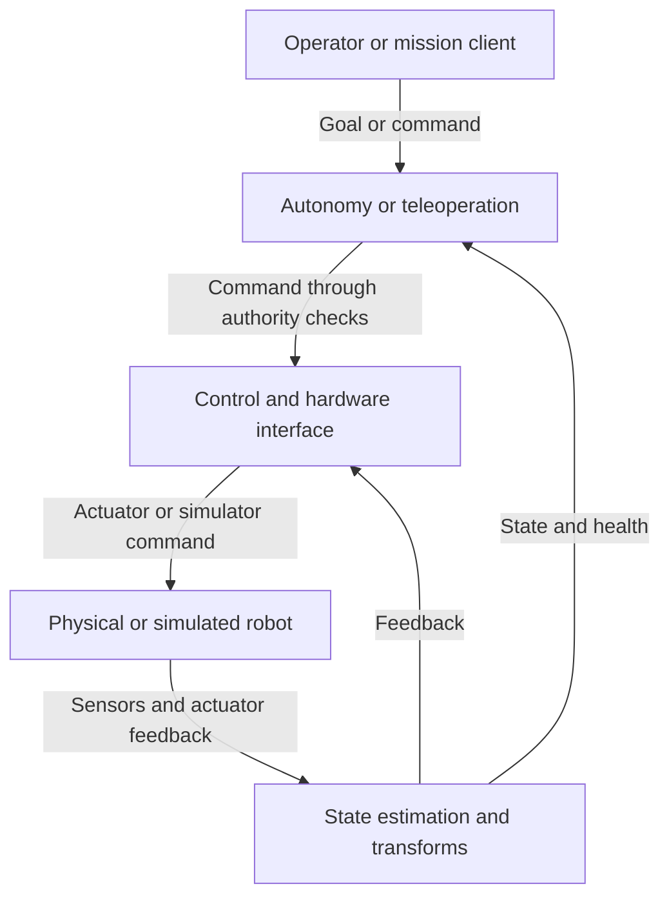

# ROS 2 Robotics Architecture

## Workflow

1. Identify the task and scope. For a design, record required capabilities, supported modes, constraints, and open decisions. For a repository review, inspect the workspace at the selected revision.
2. Start with the repository's README, manifests and build files, dependency manifests, launch entry points, parameters, robot models, and tests. Trace public entry points through installed resources and generated artifacts back to the versioned source. Inspect existing documentation before editing it.
3. Map the runtime for each supported mode. Trace command authority and feedback through the ROS graph, controllers, hardware drivers or simulation adapters, firmware, time sources, and supervision. Select relevant robot-family and software-capability concerns from the embedded standard.
4. Establish interface evidence. Record names, types, namespaces, remaps, ownership, QoS, units, coordinate frames, timing, and readiness for architecture-critical endpoints. When the matching environment is available, use read-only ROS introspection or authorized isolated simulation to verify the contracts. Record source evidence and runtime evidence independently.
5. Produce the requested artifacts. For full project documentation, write or update the root `ARCHITECTURE.md` using Sections 1–11 and the root `README.md` using Section 8. Explain package layout, build outputs, underlay and overlay sourcing, simulation or mock bringup, a first development change, and result reproduction. Link additional capability references when their contracts or tests need their own detail. For an audit, give findings with locations, effects, and verification steps.
6. Review the result against the checkout and target mode. Verify links, path and package names, commands, expected results, and mode boundaries. Identify unverified assumptions, missing prerequisites, and tests that require another environment. Validate simulation and hardware modes separately under the project's operating procedure.

A workspace may contain embedded software, control loops, perception, learning, navigation, manipulation, or other subsystems. Apply the relevant requirements and state why a section is inapplicable when needed. For container build and runtime composition, use the companion Docker architecture workflow when available.

## Embedded documentation standard

Use the numbered headings below for a full project architecture. Use the README requirements in Section 8 for the public walkthrough. Mark proposed choices, source-verified facts, runtime-verified observations, and unresolved items as applicable. Link the evidence a reader needs to reproduce or review the result.

### 1. Project Structure

Include an annotated directory tree in Section 1. Start at the repository root and show `README.md`, `ARCHITECTURE.md`, the actual build and launch entry points, tests, and any documentation assets. Use verified paths for an existing checkout and label a proposed layout as such. Show where README figures and data come from. Summarize generated output paths separately when relevant.

Illustrative repository root.

```text
robot_ws/
├── README.md                  # Visual quickstart, development, and reproduction
├── ARCHITECTURE.md            # Package map, interfaces, and runtime explanation
├── dependencies.repos         # Source dependencies when used
├── docs/
│   ├── media/                # Robot and simulator screenshots
│   └── figures/              # Plots, diagrams, and sources
└── src/
    └── robot_bringup/
        ├── package.xml        # ROS package manifest
        ├── CMakeLists.txt     # Build recipe for this ament_cmake example
        ├── launch/            # Launch entry points
        └── config/            # Parameters and robot configuration
```

Map these responsibilities to the actual repository, package, or vendor system. A responsibility can span several packages or live in a separate repository.

| Responsibility | What to locate and record |
| --- | --- |
| Package and workspace metadata | Workspace manifest, `package.xml`, build type and files, dependency lock or `.repos` files, and generated artifact locations. |
| Robot model | URDF/Xacro, SDF or equivalent, meshes, joint and actuator names, inertial and collision definitions, calibration ownership, and model variants. |
| Configuration and bringup | Operator-edited configuration, parameter defaults and overlays, launch entry points, generated output, lifecycle orchestration, and hardware-selection logic. |
| Control and hardware I/O | State and command interfaces, controller manager or equivalent, vendor driver/gateway, firmware boundary, actuator mapping, and bus/device configuration. |
| Application and tooling | Packages for mission logic, planning, perception, estimation, operator interfaces, and any learned policies actually used. |
| Simulation and testing | Simulator adapters, assets and worlds, mocks, test fixtures, scenario definitions, CI workflows, and bench or hardware test tooling. |

Document how to find each component starting from its public launch file, package export, or service. Identify the source file to change for generated artifacts.

### 2. High-Level System Diagram

Draw the real system boundary, identify which processes run on which compute device, and trace both command and feedback paths. The example below shows roles. Replace the labels with real components and split roles across hosts or firmware where the system does so.



Trace startup from authoritative configuration to active components. Identify command ownership, competing producers, arbitration, feedback consumers, and safe behavior on stale input or loss of connectivity. Show which boundaries change in simulation, bench, and physical deployments.

### 3. Core Components

For each implemented component, record its owning package or system, implementation, host/process, launch entry point, dependencies, inputs and outputs, and the state in which its interface becomes available.

| Component | Architecture details to record |
| --- | --- |
| Bringup and supervision | Launch composition, lifecycle transitions where used, readiness gates, startup and shutdown order, restart behavior, and how mode selection is enforced. |
| Model, sensors, and state | Model publication, state and transform publishers, estimator inputs, calibration and timestamp sources, and diagnostic owners. |
| Command arbitration and control | Command sources and precedence, interlocks, controller and hardware interfaces, update periods, latency and jitter bounds where applicable, units, limits, and timeout handling. |
| Task and autonomy layer | Planner, policy, or mission executor, action feedback and cancellation, behavior on invalid inputs, and operator override ownership. For learned policies, record the model version, observation and action contracts, inference period, and fallback. |
| Physical or simulated backend | Transport, device, firmware, or simulator adapter, the feedback it provides, and any gaps in behavior or interface parity across modes. |
| Operator and maintenance tools | Teleoperation, status, visualization, configuration or calibration UI, and diagnostics or bag capture entry points where used. |

#### ROS graph contracts

Maintain one row for each architecture-critical topic, service, or action. Use resolved names for a documented deployment and show how names are derived when configurable.

| Field | Required detail |
| --- | --- |
| Endpoint | Relative or fully qualified name, namespace/remaps, interface type, publisher/server and subscribers/clients. |
| Delivery and timing | Topic QoS, expected rate, startup readiness, latency or deadlines where relevant, and behavior on stale data, lost data, or disconnects. |
| Data semantics | Units, frame IDs, sign conventions, timestamp and clock source, valid range, and how errors are signaled. |
| Command semantics | Who can command, who arbitrates, how commands expire, what cancellation means, and what status confirms acceptance or completion. |

Record TF parent/child direction, the authority for each critical dynamic transform, static transforms, and where frame conventions change. Document wall time, ROS time, simulation `/clock`, and hardware time where used. Verify the graph against the running system with `ros2 node info`, `ros2 topic info -v`, `ros2 action info`, `ros2 param get`, or the relevant introspection tools. See [ROS 2 QoS](https://docs.ros.org/en/jazzy/Concepts/Intermediate/About-Quality-of-Service-Settings.html) and [ros2_control architecture](https://control.ros.org/jazzy/doc/getting_started/getting_started.html).

#### Robot-family considerations

Apply every row relevant to the system. Each entry names evidence to document, with the concrete technology selected by the project.

| Robot family | Interfaces and boundaries to capture |
| --- | --- |
| Manipulator or gripper | Joint groups, joint order, tool/end-effector frames, trajectory or task action, collision scene, grasp or force interface, limits, and stop/cancel behavior. |
| Legged system | Body and contact frames, estimator and gait/policy ownership, effort or position interfaces, contact feedback, loop deadlines, and fall/recovery states. |
| Aerial robot | Autopilot versus companion-computer authority, flight modes, arming ownership, coordinate and timestamp conversions, failsafe ownership, and simulator or HIL integration. See [PX4 ROS 2 integration](https://docs.px4.io/main/en/ros2/user_guide) for one example. |
| Ground, marine, or other mobile platform | Kinematics or propulsion model, body/reference frames, local state estimation, command and feedback interfaces, and navigation/localization if implemented. |
| Mobile manipulator or other hybrid | Resource ownership across subsystems, coordinated frames and timing, shared workspace or collision constraints, and cross-subsystem stop behavior. |

### 4. Data Stores

Inventory source-of-truth configuration, calibration, model artifacts, maps or world assets, logs, ROS bags, and any application stores. Give each item a location, format, producer, consumer, retention rule, and backup or regeneration procedure. Distinguish authored configuration from installed, expanded, or generated files. If bag replay is supported, record topics, QoS overrides, timestamps, and the environment where replay is allowed.

### 5. External Integrations / APIs

Record the external interface, owner, compatible versions, activation/configuration method, failure behavior, and test double. Consider ROS middleware and discovery, a vendor SDK or firmware protocol, device buses such as CAN or EtherCAT, an autopilot bridge, external clocks, a simulator bridge, and operator or fleet APIs where applicable. Document schema and version compatibility across repositories, and describe transport, units, frame conversions, and timing at each boundary.

### 6. Deployment & Infrastructure

- List the supported ROS 2 distro, OS, CPU/GPU architecture, firmware, middleware, and simulator or vendor runtime per target.
- Document which components run on the operator station, onboard computer, embedded controller, or simulation host. Record networking/discovery, device access, setup paths, startup unit or launcher, and the selected time source per target.
- Explain build and install outputs, runtime dependencies, provisioning, and CI stages. Define readiness in terms of observed behavior such as active controllers, fresh feedback, or a usable transform chain.
- Record health indicators, diagnostics, logs, and how a release is rolled back. For control loops with timing requirements, name the measurement method and where it runs.

### 7. Security Considerations

Record host and ROS graph trust boundaries, authentication and authorization where implemented, credentials and encryption where required, device permissions, and who can publish to command channels or change configuration. A ROS domain ID helps separate discovery and does not grant access control. Document the owner and scope of interlocks, safe states, and recovery criteria using the platform's approved operating procedure. Treat an active controller, an observable ROS graph, and permission to actuate as distinct conditions. Identify how simulation and replay are isolated from live actuators.

### 8. Development & Testing Environment

1. Record the supported prerequisites, dependency installation, exact build/test commands, and how to source the intended underlay and overlay. Use the repository's package build systems and test tools.
2. Check configuration and model generation before runtime. Verify model joints, time and namespaces, resolved interfaces and types, TF ownership, and any expected generator outputs.
3. Run node and integration tests in isolation. Start the target simulation or mock launch, check control lifecycle and feedback, and test timeout, disconnect, invalid input, and recovery behavior as applicable.
4. Run bench, HIL, or physical tests under the project's operating procedure where applicable. Record the target revision, conditions, acceptance thresholds, and results. A simulation result is evidence for the simulated configuration.
5. Document the actual lint and CI gates, plus reproduction commands and links to known test limitations.

#### Required project README

Write a root `README.md` that a new contributor can use from a clean checkout. Open with the project goal, what the robot or stack does, and a representative result. Link to `ARCHITECTURE.md` and add a table of contents when the guide is long. Use explanatory prose alongside commands so readers understand why they are doing each step and how it connects to the result.

##### README walkthrough

Each numbered step states its purpose, the working directory and prerequisites, the exact commands or edits, what it consumes and produces, and how to check success. Include representative output and a recovery step for common errors. Label example output and record which steps were verified, where they were run, and which require a different host, simulator, or robot.

| README section | What it must contain |
| --- | --- |
| Overview and what you will reproduce | Describe the robot, scenario, expected behavior, and one demonstrable result or acceptance check. |
| Prerequisites and inputs | Give a compatibility table and identify the exact revision, dependencies, configuration, assets, and data needed for the demonstrated path. |
| Quickstart from a clean checkout | Use a numbered setup, build, launch, and verification sequence. Define every variable and mark commands that run in another shell, host, or container. |
| Start developing | Walk through one small change, identify the file to edit, explain its role, rebuild or restart the affected components, and run the relevant checks. |
| Reproduce the result | Pin the scenario, configuration, and seed when relevant. Give the command, result directory, expected logs or metrics, acceptance tolerances if applicable, and the procedure to regenerate figures. |
| Troubleshooting and cleanup | Pair common symptoms with diagnostics and fixes. Give the shutdown and cleanup commands and identify any data they affect. |

##### Visual and technical evidence

- Use a representative robot, simulator, or runtime screenshot when available. Add alt text, a caption describing what to look for, and the scenario or revision where it was captured. Label illustrations and placeholders explicitly.
- Use a graph, figure, or infographic to explain a relationship the reader needs to follow, such as data flow, startup order, or the development loop. Use an annotated screenshot for UI checkpoints where useful. Keep diagrams close to the relevant steps.
- Use tables for exact comparisons such as compatibility, configurations, or expected outputs. Include plots when results depend on measured data. Label axes and units, record the data and run conditions, and link the commands or scripts that generate them.
- Include equations when they explain a calculation, controller, or metric. Define symbols, units, and assumptions, and connect the equation to the relevant configuration or result.
- Store repository-owned media and reproducible figure sources under documented paths such as `docs/media/` or `docs/figures/`. Use working relative links and preview the README on the target renderer. Identify the source and license for third-party material.

For a ROS 2 workspace, explain what the build creates, how packages and dependencies are discovered, where launch, configuration, and model files are installed, and why the new shell must source the selected underlay and overlay. Walk through dependency resolution, build, and simulation or mock bringup before verification. Show how to inspect the actual graph, state feedback, TF, and time source. Document the physical-hardware path separately when the repository supports it.

### 9. Future Considerations / Roadmap

Record verified upstream plans separately from project proposals. For each open issue, give the affected contract, impact, owner or issue link, and review trigger. Common review triggers include a ROS distro upgrade, driver or firmware revision, a model or calibration change, new command authority, and a simulator migration.

### 10. Project Identification

For a new project, fill in the following before sharing this document.

| Field | Required record |
| --- | --- |
| Project and owner | Project name, team, and maintainer or support link. |
| Source baseline | Repository URLs, exact revisions or release tags, and date reviewed. |
| Deployment modes | Supported physical hardware, simulator and/or test backends, and release compatibility. |
| Evidence | Source and documentation links, runtime validation status, and the date of the last update. |

### 11. Glossary / Acronyms

| Term | Meaning |
| --- | --- |
| ROS graph | Nodes and their topic, service, and action connections. |
| URDF / Xacro / SDF | Robot or simulation description formats and a macro language used to generate XML robot descriptions. |
| TF / tf2 | Time-indexed coordinate transforms and the ROS 2 tooling that distributes and queries them. |
| QoS / RMW | Quality of Service settings and the ROS middleware interface/implementation layer. |
| HIL / SIL | Hardware-in-the-loop and software-in-the-loop validation. |
| Underlay / overlay | Installed ROS or dependency workspace, and the overlying workspace that can extend or shadow it. |
